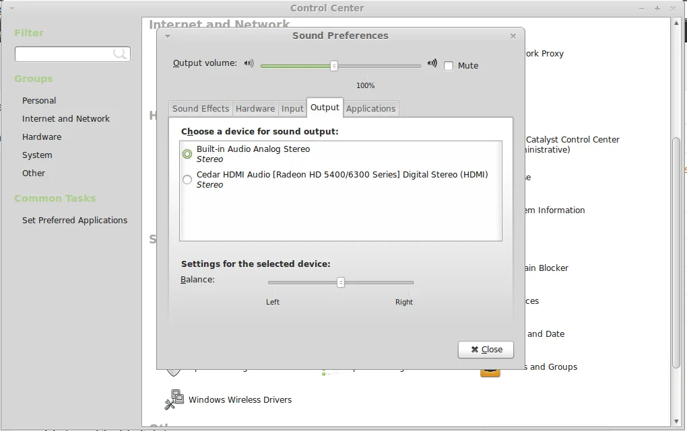

This article involves choosing a non-default sound device.

#### Description:

1.When Adobe flash player 11 played online music, it went too fast. As soon as a certain point was buffered, the player jumped to it; in other word, if at this time the player was playing at 1:20, and the media was buffered till 2:30, then the player skipped the music between 1:20 and 2:30, and jumped to the 2:30 point. (I hope I have made myself understood) This is similar for local music player Banshee, though it did not buffer the music.

2. When a music or a video was played, pressing volume up/down button on the keyboard or directly using the volume control on desktop did not change the volume at all.

#### Solutions:

I first suspected that the flash player was not working properly. However, while I was re-installing the plugin, I happened to download a music, and realize that it didn’t work properly in my disk as well. Then I opened the control center, and realized the cause related to the sound device. I had two listed sound device, and the default choice was the HDMI one, as shown below. I chose the built-in one, and it worked sometimes, but after reboot, the device in work became the HDMI again.

Then this [thread](http://forums.linuxmint.com/viewtopic.php?f=48&t=95337) worked out.

And here’s my output

`$ sudo cat /proc/asound/modules`

`[sudo] password for ao:`

`0 snd_hda_intel`

`1 snd_hda_intel`

Yes, there were actually no difference between these two; I believe if you get this output as well, you may refer to the index of item in your Sound Preferences in Control Center, (i.e. the first= index=0)

Follow the instructions in the link, and hopefully it will work fine.
