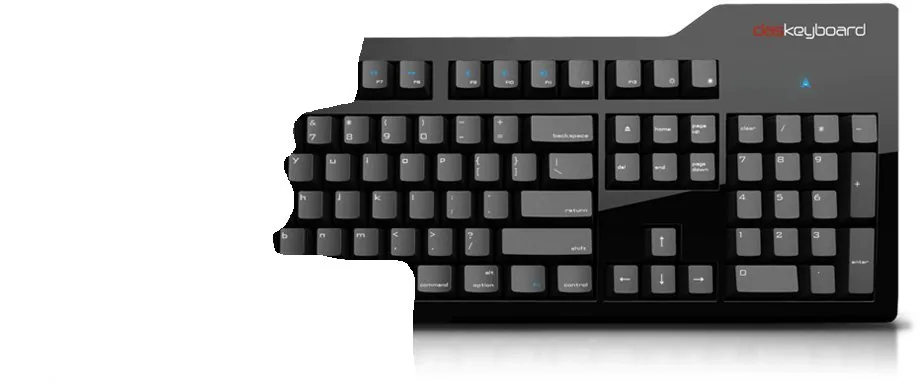
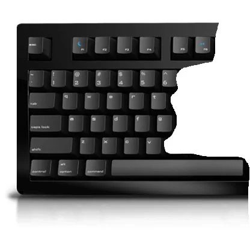

*This is by no means an outline of a product–simply a fun idea of mine (hopefully fun to you as well).*

I am tired of sitting beside my desk staring at my computer screen and **typing**. If I keep this position for a long time, my neck aches, my waist feels rigid, and most importantly, my hand wrist becomes painful (I put my keyboard on my lap). The most relaxed posture is to lie. I meant no compromise, no pillow behind your back. Just lie down, in the same position as you sleep.

However, it is hard to type, given that two hands are at different sides of my body. Here is the main point–we can have a keyboard split into two parts, one part for left hand and the other part for the right. I tried to type with two keyboards, and it feels good. The two parts of keyboard can be coordinated by wireless adapter, or to keep it cheap, one wire can be used to connect the keyboard to laptop, while the wire in the middle split into two, each controlling one part.

Other appliances should also be modified for the new setting, such as a screen on ceiling, but big (or close) enough for users to see clearly, and stably connected to the ceiling so that it does not fall down and cause damage (earthquake is not taken into consideration), etc.

(Just found a cool solution:  
<http://www.ebay.com/itm/NEW-Horizontal-Reading-Lazy-Lie-Down-Mirror-TV-Sit-View-Glasses-On-Bed-Lie-Down-/251240752410?pt=LH_DefaultDomain_0&hash=item3a7f1da51a>  
Use glasses instead)

Below are two pictures to illustrate the idea:

(I wonder if it is necessary to keep the small number keyboard, which breaks the balance when putting keyboard on laps and is not used often)
