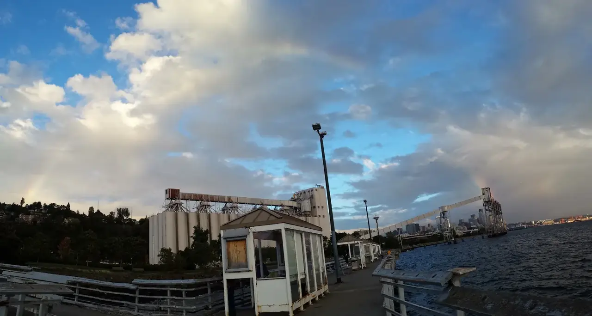
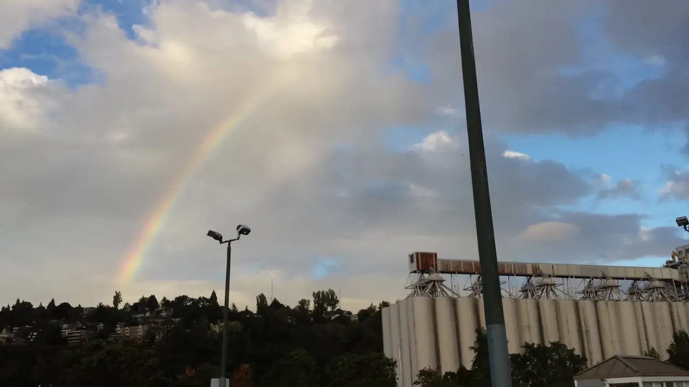
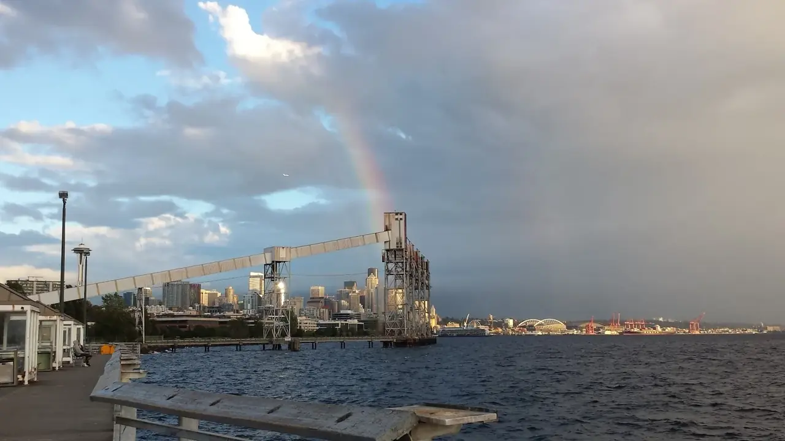
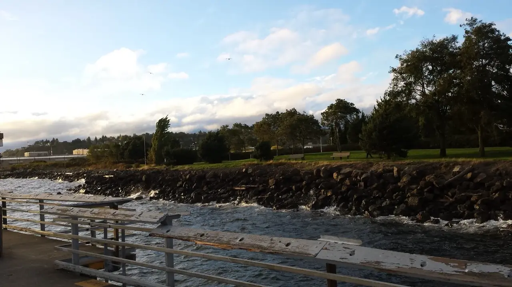

饭余漫骑，闲坐钓台。中秋未及，西城却已抹上浓浓天蓝与红枫色。鸥雁向东南，肥硕的黑颈天鹅也扑棱远去，不时“额啊！额啊！”地呼喝着。海风猎猎，挟着小雨，卷着半边天的云雾，向晴朗的半边漫延。瑟瑟中，抬眼却见市中心彩虹的一脚独矗着，光带宽阔，似是一个大圆的小弧。惊喜抬眼东望，竟然真的有虹的彼端，在云中隐现。更有趣的是，虹随着风雨向东缓缓地踱去，随烟雨消散，渐渐只剩隐约的一只脚。暮色更浓，湛蓝的海染了墨色，更显寒冷。

