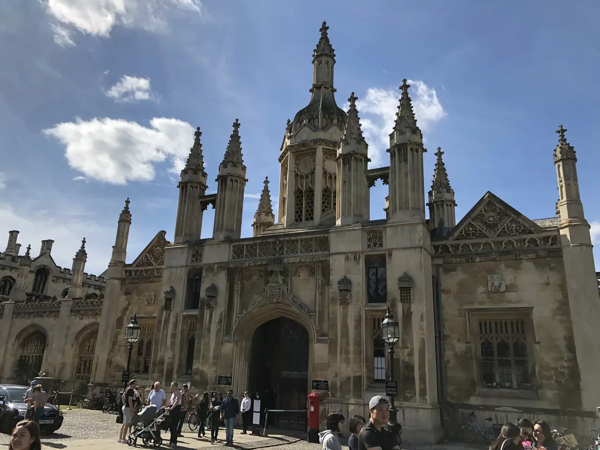
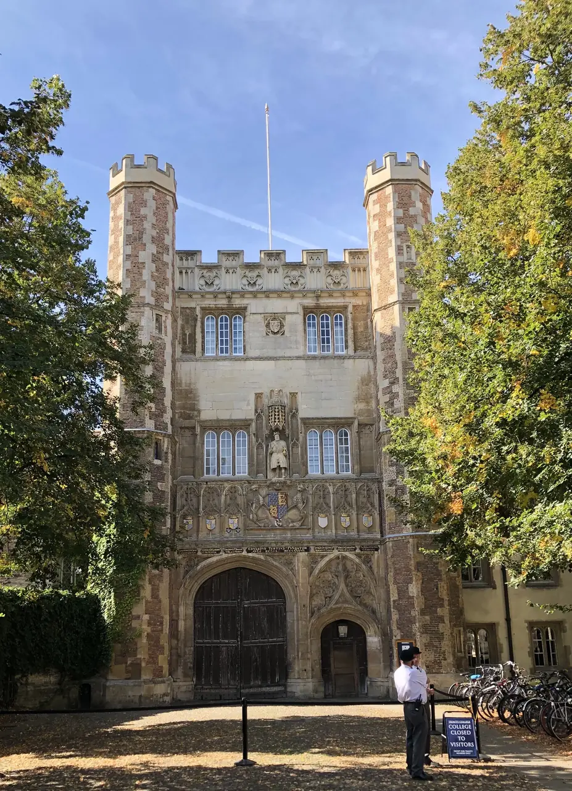
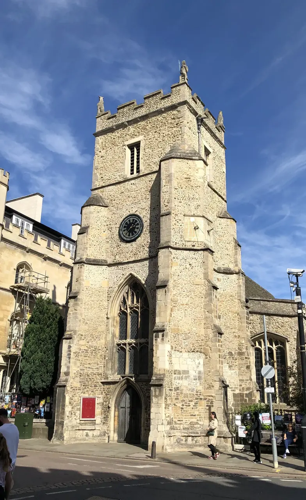
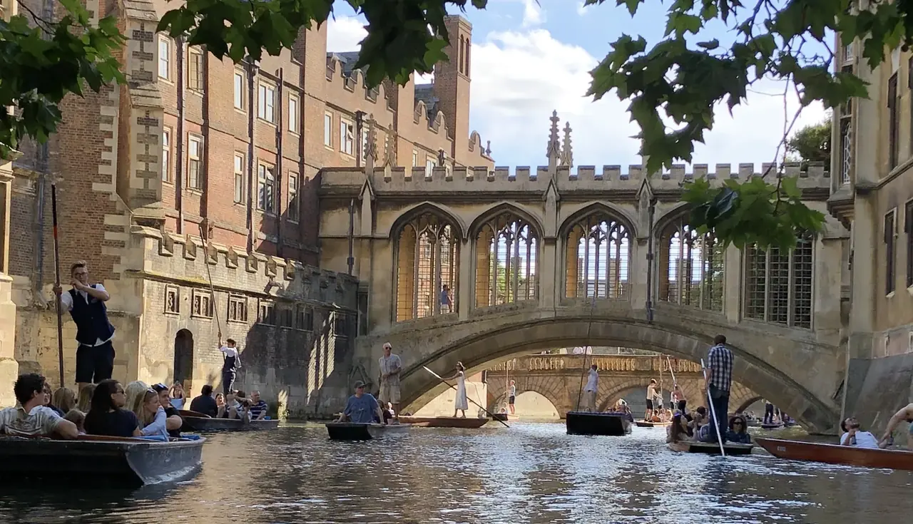
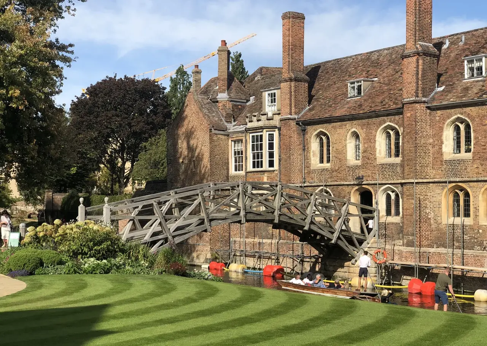

剑桥是一个很奇葩的地方。

一座学校竟然有三十一座学院，而大部分学院是综合性的学校，亦即在学院中可以选修许多专业的课程。

一座学院里没有教室，只有住房。与美国大学不同，学院不对外开放—除非你掏钱。每所学校会收门票钱允许游客参观。

King’s College

剑桥富到流油，而最牛逼的学院三一学院，估计是富到流玫瑰精油。据说从剑桥到伦敦不需要离开三一学院的路就能到达。

Trinity College

剑桥的corpus christi学院（翻译过来或许是圣尸学院？）门口有面[尸钟](https://en.m.wikipedia.org/wiki/Corpus_Clock)。诡异狰狞的一只金色大蝗虫趴在电子摆钟上，咀嚼每一秒流逝的时间。说是“秒”或许不准确，因为时钟五分钟才准一次。寓意大致是世事难料，逝者如斯。倒是解说的小哥认为被蝗虫吞噬的时间已往而不谏，不若好好享受青春。学院风闻闹鬼，是十七世纪自杀的灵魂，总觉得此学院中有两三条不和谐的思想交织糅合，圣尸学院也算名副其实。

<iframe src="https://video.wordpress.com/embed/K0VWyCSN?hd=0&autoPlay=0&permalink=1&loop=0&preloadContent=metadata&muted=0&playsinline=0&controls=1&cover=1" title="VideoPress Video Player" loading="lazy" allowfullscreen style="width:100%;aspect-ratio:16/9;border:0;"></iframe>

Corpus College

在剑桥不提康桥似乎对不起徐志摩那首软软的诗作：

> 寻梦？撑一支长篙/

> 向青草更青处漫溯/

> 满载一船星辉/

> 在星辉斑斓里放歌

许多朋友不喜欢徐志摩，大多因为新诗的朦胧柔软，而这却恰是我欣赏他的一点。我喜欢这个在雨中等虹的诗人。

Kitchen Bridge

在皇后学院，有一座数学桥(Math Bridge)，据说是牛顿设计的–虽然桥在前者死后十几年才开建。原作据说没有用到一根钉子，而是通过巧妙的重力与结构设计保持桥的稳定性–虽然，桥后来被学生拆了做研究用，结果不用钉子就拼不回去了，于是桥上无奈的多了些钉眼。想来当时的英国人是不知道榫接的。

Math Bridge
