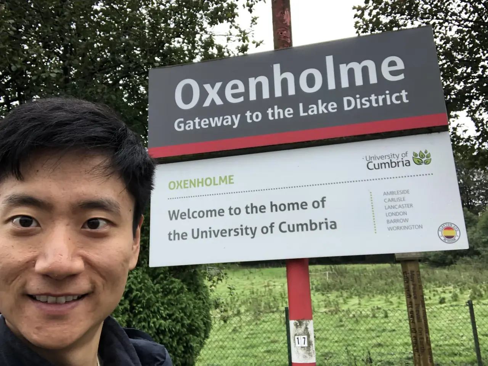
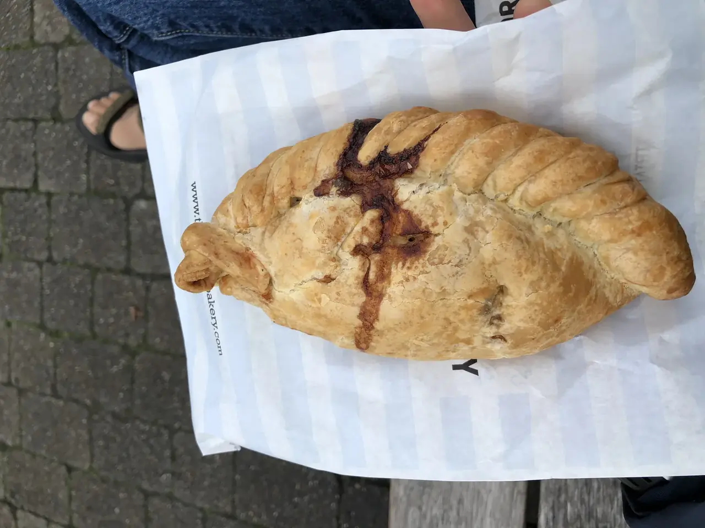
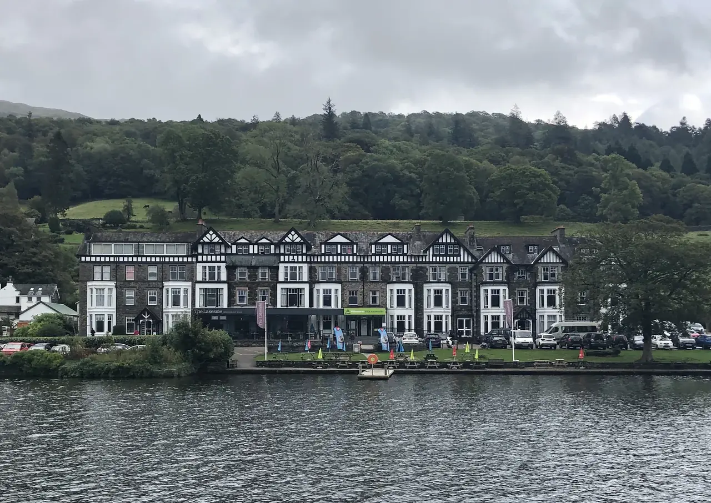
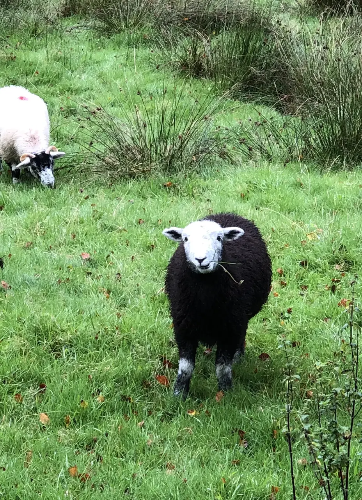
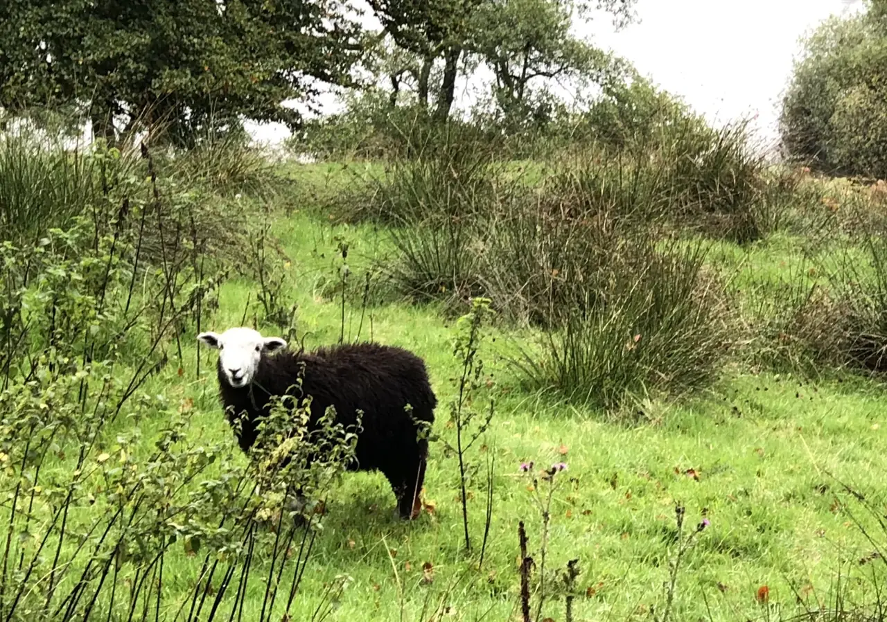
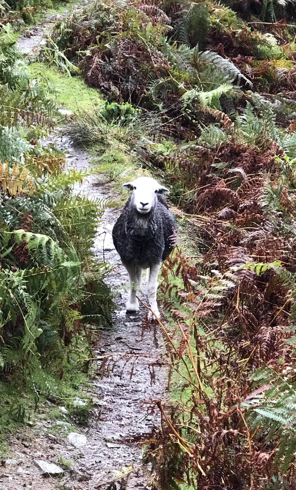
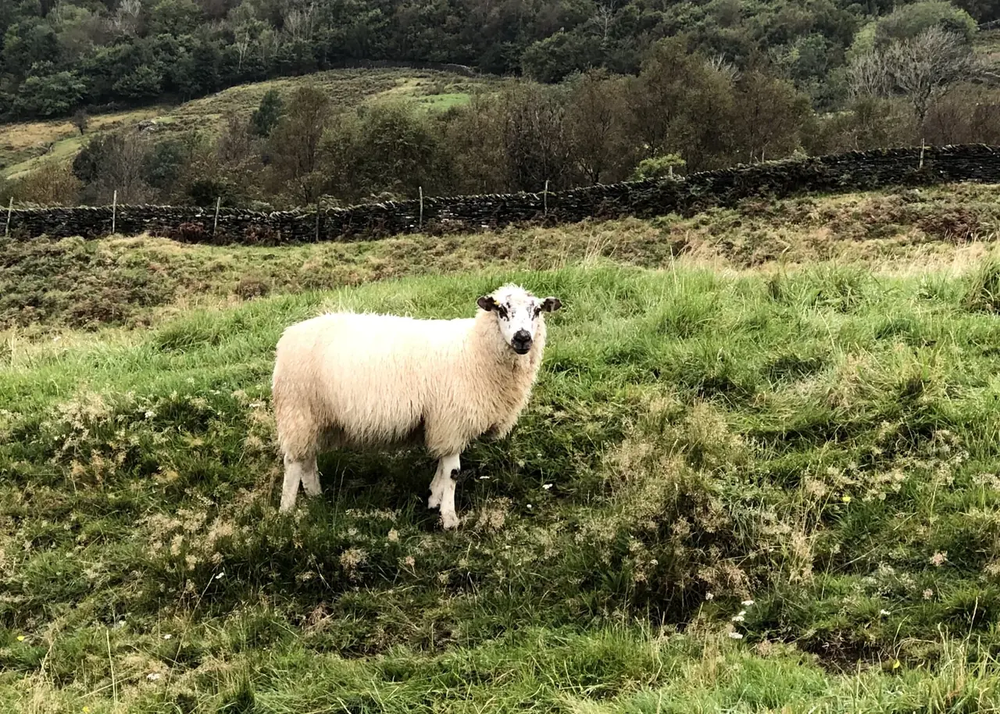
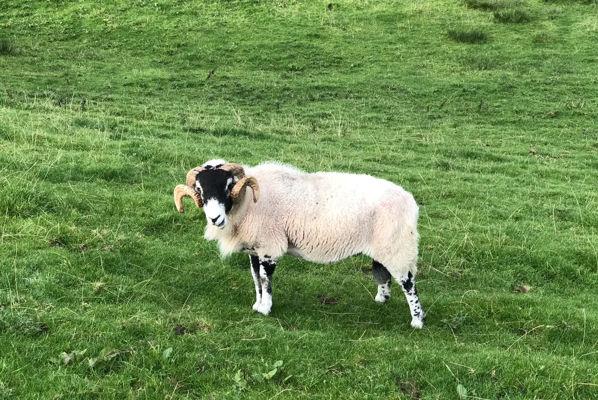
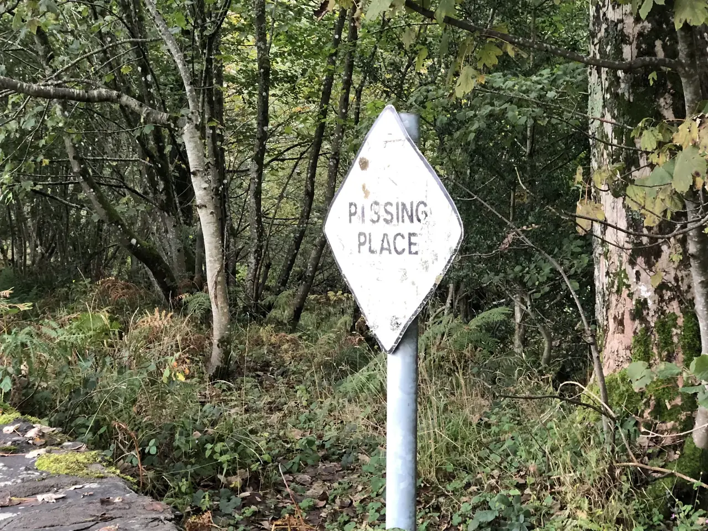
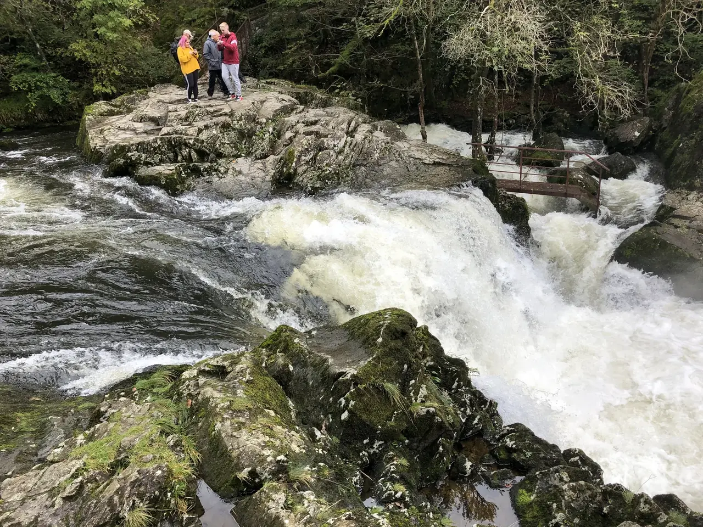

Oxenholme – Windermere – Ambleside – Elterwater

（傲客森湖 – 闻到木耳 – 安步思德 – 傲特二水）

常说外出的游子会时不时想家，因为旧居的桑梓树，或是村口期盼的大黄狗，甚至只是粽叶包裹的软糯，也足够人惦记的。没想到我在英国著名的旅游景点湖区，挂念的却是西雅图后院的从峦叠翠与皑皑白雪。归根结底，还是英国

实在是太平了！

在爱丁堡的青旅遇到一个荷兰小哥，刚从苏格兰西部海岸线徒步回来。全程150千米，用时七天。初时我拿华州的雷尼尔雪山环线步道Wonderland Trail作比，深以为小哥之牛逼，毕竟一个人走这么长的路，还是需要相当的执著耐力。直到我亲自在湖区走了一圈。

从格拉斯哥坐车到了傲客森湖，我才发现多坐了一站，应该闻到木耳就下车的。好在车站口遇见一位慷慨的英国老太没赶上火车，拉着我搭上朋友的顺风车一路捎我回了闻到木耳。闻到木耳是个湖边小镇，风景如画游人如织。

Oxenholme station

Cornish

坐渡轮去了安步思德。青旅傍湖而建，出门便是渡口，除了渡轮还有手摇木筏，配上烟雨迷蒙，想来颇有一些意趣。

Hostel from the lake

湖区适合山地车，也适合走路。走路在北美称为hike，徒步在欧洲称为walk。我认为区别来源于欧洲的自然环境在千年的文明中得到了充分开发，出门徒步就如同在后院散步一样，坐上公交很方便就能到达，而且徒步沿途露营设施十分齐整，常常有小木屋供行者使用；而如在年轻的美洲，西部有大片人类鲜有涉足的山林，往往需要开三四个小时的车一路颠簸在坑坑洼洼的小路上才能抵达，更何况徒步时大多要搭帐篷拼炉灶。考虑到湖区的徒步状况，称之为walk更为确切。

旅店的前台给我推荐了爬上店后小山（丘）的环线，于是我光着脚拖着鞋出发了。路上最大的挑战并非爬山，而是拖着鞋走湿漉漉满是羊粪的草地非常不舒服，幸而一路有黑色蛞蝓的陪伴。它们不像太平洋西北地区的香蕉蛞蝓那样大只，而且黑的透亮。远处的漫漫无边际的丘陵缺少显赫的高峰与陡峭的岩壁，多的是深青色的草铺满温柔起伏的曲线，偶尔镶嵌着一泊小湖。视野中无时无刻都是白色胖乎乎的一团团，隐在低垂的雾帘后，仿佛是凝结的雾，风一吹便要化成雨飘走一般。

<iframe src="https://video.wordpress.com/embed/DWPMjPP5?hd=0&autoPlay=0&permalink=1&loop=0&preloadContent=metadata&muted=0&playsinline=0&controls=1&cover=1" title="VideoPress Video Player" loading="lazy" allowfullscreen style="width:100%;aspect-ratio:16/9;border:0;"></iframe>

Wansfell Pike (peak)

羊毛厚实，即使浸了水也能保暖。在英格兰无常的急风骤雨中，前一秒还是游客兴高采烈地惊动山坡上白云摇动，下一秒就见羊施施然咀嚼着青草，入定般看着步道上慌乱避雨的游客。而经验丰富的本地行者，则深通绵羊之道，与羊互不惊扰，施施然在风雨中漫步。

呆呆羊之一

呆呆羊之二

呆呆羊之三

呆呆羊之四

威风羊

第二天与同宿舍的温哥华叔叔结伴走去了毗邻的小村傲特二水，路途上顺便爬了一座小丘。在泥泞的步道上，我们不时要一脚深一脚浅地跨过草地，泥浆漫过脚面，粘在裤脚上和指甲缝里。急雨时而收时而落，令人无处适从。狼狈中唯一庆幸的，便是英格兰的较高的温度。若是华州的山水，必定是凄风冷雨冰山雪水。

Pissing or passing

Skelwith “Fall”(?)

听本地人说，湖区曾在二战后1945年接纳了300名从集中营拯救的孩童。湖区的宁静给了许多人重创心灵上的慰藉。[70](https://www.telegraph.co.uk/history/world-war-two/11370112/From-the-Holocaust-to-Lake-Windermere.html)[年后，湖区再次接纳了来自已散在天南海北的他们](https://www.telegraph.co.uk/history/world-war-two/11370112/From-the-Holocaust-to-Lake-Windermere.html)。回忆过往当是唏嘘不已。我想，巍峨的高山固然能磨练人的心性，然而温柔的丘陵和湖水却更适合恢复人心的伤疤。我常嘲笑不列颠地势太平，若是地势太平令人心太平，又何乐而不为呢？
