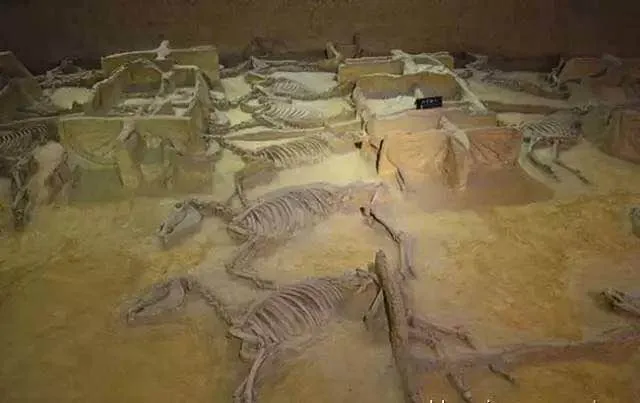

<https://www.sohu.com/a/134935233_141088>

他娘的！狗屁领导！

二零零四年在洛阳文化中心广场施工处发现车马坑，惊现周天子六驾的墓，规模达三万平方米。即使作为一个普通人，看着这六匹马的遗骸也可以想象墓中隐藏着多么重要的历史文化财富。洛阳政府于是做出了明智的决定：回填。墓坑就在对于文物的漠视中第二次被埋葬。恬不知耻的媒体称之为“回填保护”。当然，文物保护要为城市发展让道！将来或许有机会开发，即使代价是二次损毁。

呜呼！周天子你过气的人就好好歇着吧！
