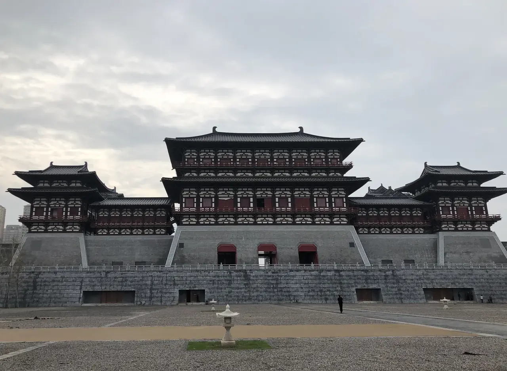
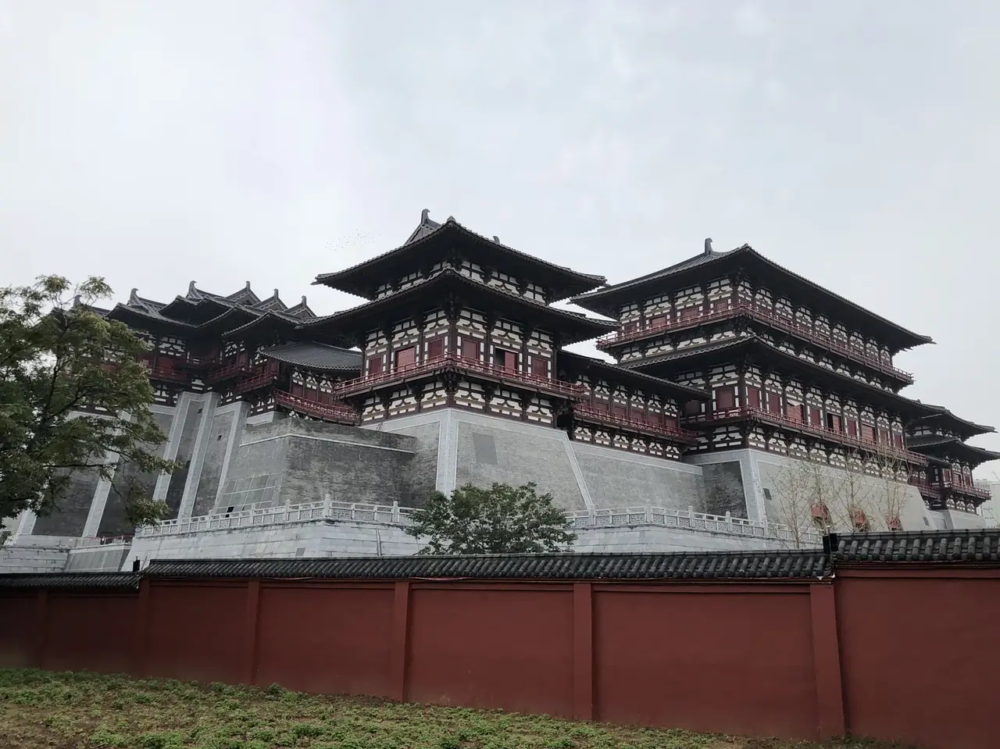
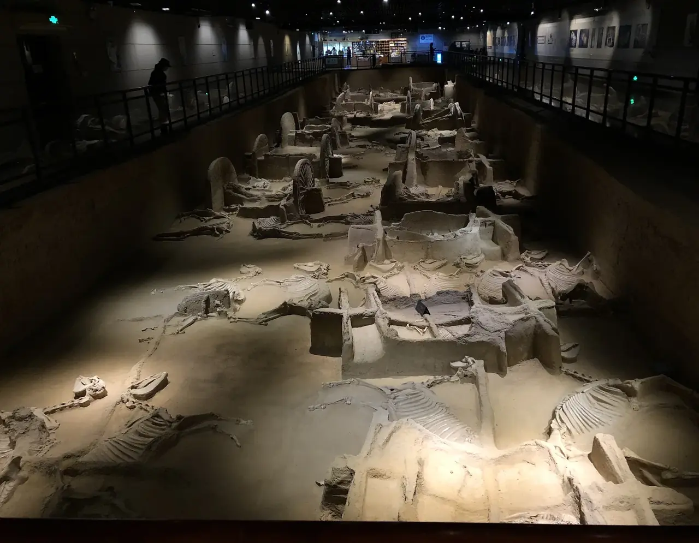
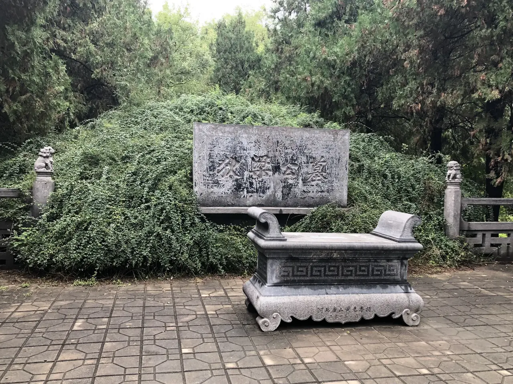
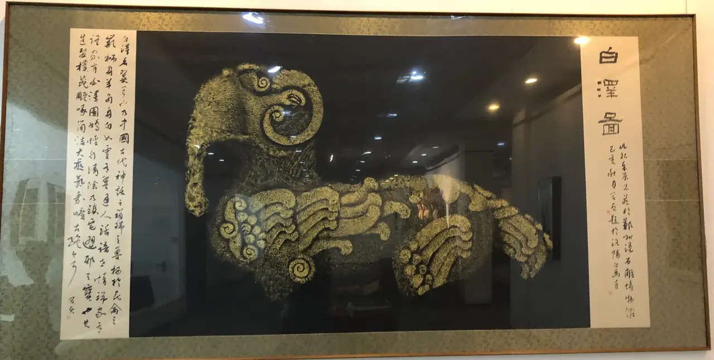
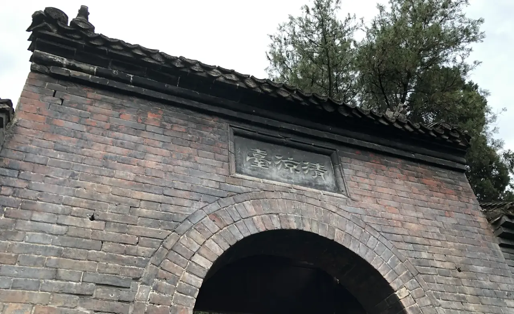
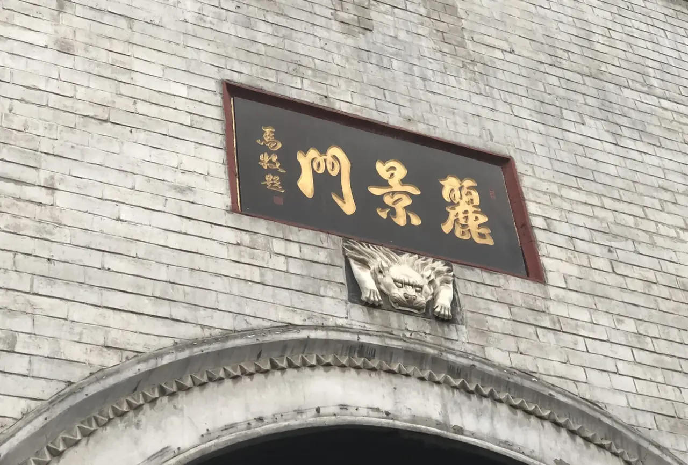

在封建王朝统治历史上，尤其在唐朝以前，洛阳与西安两城用“皇帝轮流**坐**，明年到我家”来比喻毫不夸张。从周到唐，帝都在两者间更替大致如下：

西周（镐京|西安）→东周（洛邑|洛阳）→……→西汉（长安|西安）→东汉（洛阳）→三国曹魏（洛阳）→西晋（洛阳）→……→隋（大兴|西安）→唐（长安|西安）

在古城的呼唤中，我们乘坐五个多小时高铁到达洛阳龙门。十月九日傍晚，洛阳雨。细密的雨点冲刷陈旧的街道，踏上蒙尘的公交车，新安装扫码机的电子滴滴声在车的老旧中格格不入。在公交车上近一个小时的车程中，汗味烟味车油味人油味在狭窄拥挤的车厢内发酵膨胀，洛阳人怀疑的眼神交织成网，让人透不过气来。在宾馆卸下行李外出觅食，踏着破裂的地砖，时刻提防地砖下泥水溅出，却发现多数餐馆门可罗雀。不得已去了家四川烤鱼店，一个穿汉服的圆脸小姑娘不耐烦地为我们介绍套餐，手边不住地敲打菜单。估计是无法忍受我们没有立刻下单，她叫上一个呆头实习生模样的小男孩给我们点菜，自己一溜烟跑去接待另一大桌客人了。终于，千呼万唤始出来的酸菜烤鱼横尸桌上，它的头深深埋在烤盘里，同样的爱理不理——这是洛阳的鱼。

十月十日，阴。我们胡乱逛到了定鼎门。定鼎门取义于周武王迁九鼎于洛阳，是隋唐洛阳城的外城正门。用以纪念隋唐的遗迹空有规模，反而比公交车少了些尘土气。钢筋从城墙脚薄薄的水泥板下透出。门票需要提前一天预订，而我们没有预定被拒之门外，望空空的博物馆而兴叹。同时拒之门外的还有本地人打扮的老大爷，和门卫大爷言语不和，揎拳掳袖指鼻子骂娘。如果两人各年轻二十岁，想来是要打起来的。

定鼎门

定鼎门东飞廊

[虽然前两天发了顿牢骚](http://aozhang.blog/2019/10/08/%e6%b4%9b%e9%98%b3%ef%bc%8c%e4%ba%8c%e9%9b%b6%e9%9b%b6%e5%9b%9b%e5%b9%b4/)，天子驾六还是得去参观的：

天子驾六车马坑 （横卧的六匹马为天子驾六）

虽说六匹马拉车相当威风，参考坑里天子的车辕，总令人产生疑问：这么窄的车横着拴着六匹马，不挤吗？罕王良造父之才，必然马不能行之十里。

乘公交车前往白马寺镇。白马寺始建于东汉，为中国第一座寺院，取白马驮经入洛阳之义。不知在此翻译《四十二章经》的摄摩腾和竺法兰两位高僧是否料到清康熙年间江湖为了经文中的藏宝图掀起的腥风血雨，或是在此的谈经论道情场失意的大理国王子段誉？寺东南有武唐震慑天下的名相狄梁公衣冠冢，一说墓碑是宠臣薛怀义的，因为后者也曾被封为梁国公。这就令人啼笑皆非了，堂堂一朝宰相万世景仰，死后墓地竟然和声名狼藉的男宠混不清楚。不过狄梁公宰相肚里能撑船，薛怀义就算狐假虎威蹭点香火冷猪肉，估计狄梁公也不会太在意的。

狄梁公墓

白泽相

清凉台（涼？多点水凉快）

回到市区参观丽景门。如同中国大部分古镇景区，这是一个倒卖义乌小商品的地方。门口的椒图翻着白眼睥睨拿着长枪短炮的票圈常客与暗中嘲笑被宰的游客的小商小贩们，就像它的前辈嘲笑隋唐的文人与商贾一样。

丽景门
