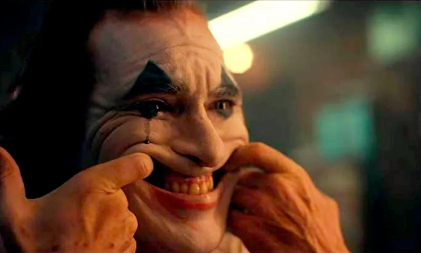

*A few questions regarding the movie Joker* (2019)

Absolutely no. You are not a joker simply because you are reading this blog, intended to be consumed by the more fortunate class of people. Remember the grassroots movement in the movie “Kill the Rich”? The Rich can’t be a joker, and believe it or not, you are probably one of “the Rich”.

Then why do I keep questioning if there’s a Joker in my mind? That’s simply from the brilliant depiction Joaquin Pheonix had on the self-conflicting nature of Arthur Fleck (the Joker), which attracted my empathy. He was a clown who intended to make others happy but he biologically was incapable of understand what being funny meant; he was skinny, frail and civil, but could hysterically suffocate a gatekeeper almost to death; he approached Thomas Wayne’s son in a very kind and gentle manner, yet the clown movement he sparkled eventually led to the boy witnessing their parents killed in cold blood. Everyone has both the good and the evil angels living in their mind, and the switching between the two appeared sudden yet compelling in Arthur Fleck; hence the question whether a Joker lives in one’s mind **should** come naturally.

Why did the movie end up with Arthur being kept in a psychiatric hospital (and chased around by another patient) (ending 1)? Towards the end of the movie, Arthur was saved from arrest. While he was escorted in a police car, it got crashed by an ambulance ran by insurgents. Insurgents transferred the injured Joker onto a car hood. Joker rose up and started his psychic but mesmerizing dance, with all insurgents hailed him as a leader and a hero. I told myself while watching it that the movie could stop here (ending 2). I think there are few reasons why Todd Phillips chose to end it in the hospital. First, Joker would completely sink into darkness if the movie had gone with ending 2, and next time Joker appeared it would just be a conglomerate of pure evils. Ending 1 still kept the self-conflicting Arthur part within Joker. Second, ending 1 tells a bigger tragedy than ending 2, that is, even after all the drama, still no one could listen to or understand Arthur. All they did was to abandon him into a desolate late of mental illness. Third, it’d be unnatural for Arthur to go dark and suddenly change from a shy and frail man to become the mastermind of crime. Lastly, having Arthur locked up in a hospital opened up opportunities for a sequel movie, where stories can be how Arthur transcends and escapes.

What’s the value of Arthur’s girlfriend? Frankly I don’t like that setting. Her existence tended to be less noticed as compared to some of the more major characters. There are two weak reasons for her existence: first, she promised to see Arthur’s comedy show, which later triggered the revenge of Arthur onto Murray Franklin; second, her entrance into Arthur’s life promised hope of his redemption, which unsurprisingly, was shattered mercilessly by the hospitalization of Arthur’s mother. Nonetheless, those could have been easily done in a more powerful plot.

One complaint I had was the ease of formation of the clown movement. Having three people shot dead by a clown should not have had such fundamental influence on social reaction. I take it that the virality could have resulted from popular life situations that Arthur faced, but that could be a bit of a stretch.

Overall I enjoyed the movie thoroughly. The psychic, uncontrollable, and mournful laughter, and the narcissistic, lonely and ungainly dance, will be forever imprinted on Joker the character.

