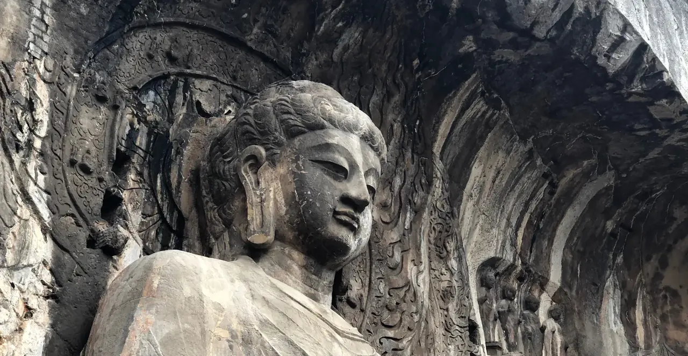
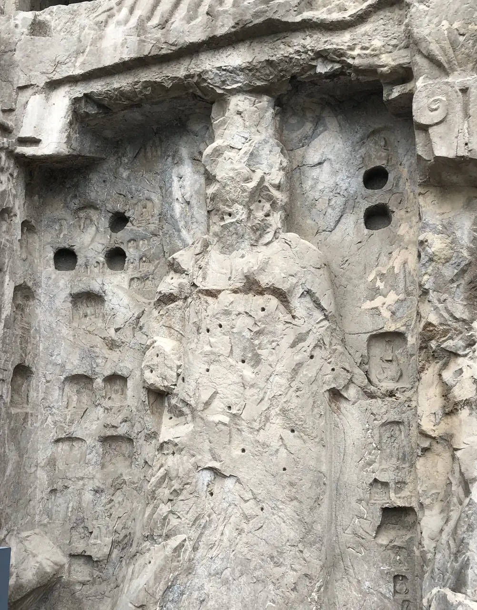
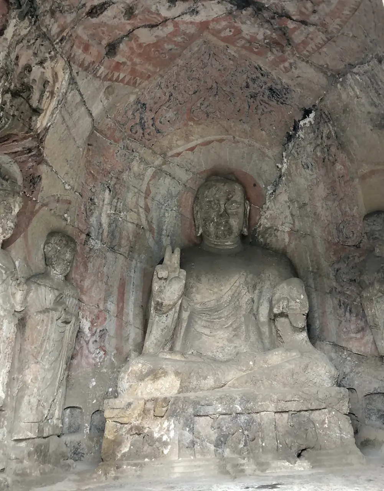
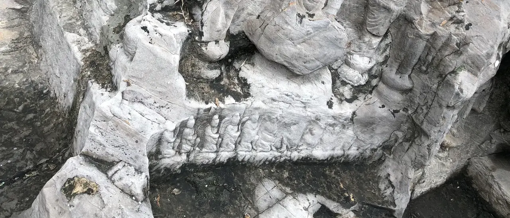
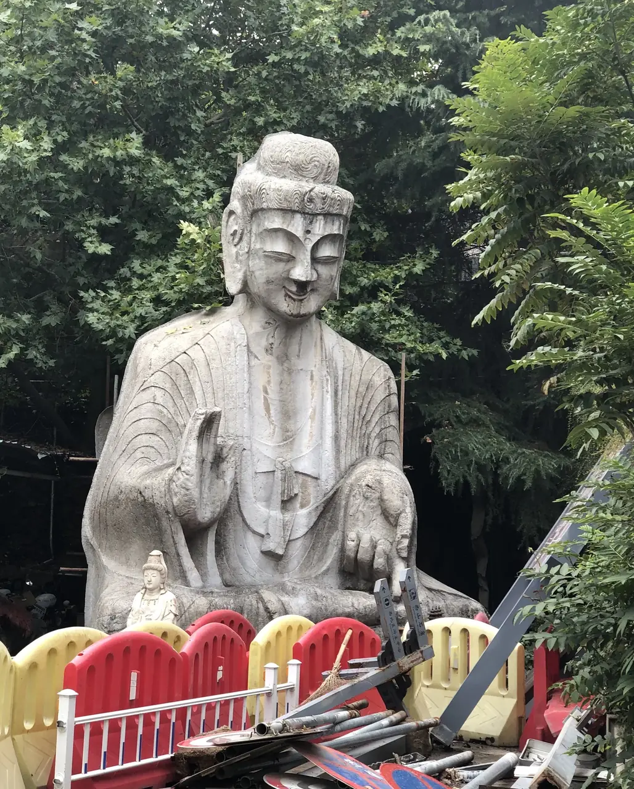
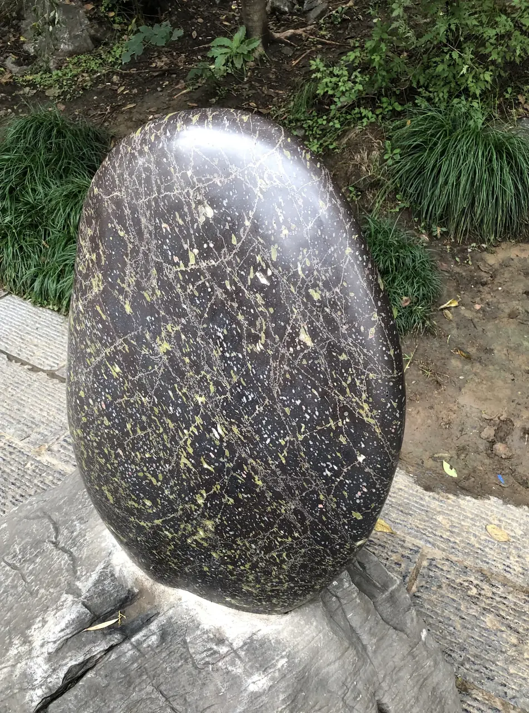
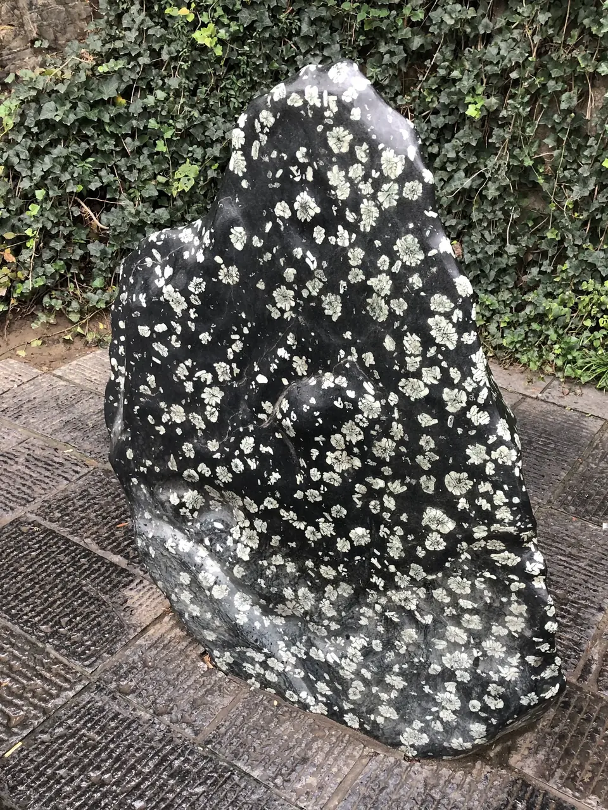
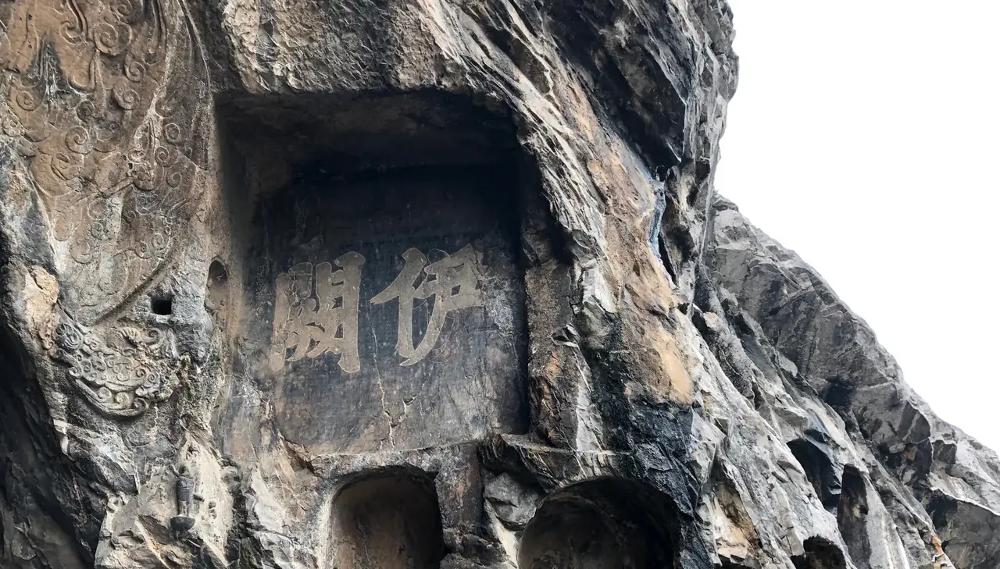

庐舍那大佛

雕刻石窟佛像一定是一件困难的事。选择合适的石质便是一件难事。敦煌的石质为砾岩，因为是许多小的石粒堆积而成，脆弱易损不适合直接凿石雕刻。云冈的石质为石英砂岩，硬度适中便于雕刻，同时耐风化，所以很适合石雕。而龙门的石质为石灰岩，硬度适中而不太耐风化。其次，从佛龛中凿的石像容错率非常低，而不像先把佛龛凿空，把外部雕刻好的佛像运进来。后者最差就是换块石胚重凿，而前者则必须在原基础上加以修复。再次，像庐舍那这样的宏伟巨制须得一队能工巧匠在高空作业数年。想来匠人是不能边作业而边从远处观察调整的。若是把观察者和施工者分为两队，则沟通又成了问题。再次，因为工期漫长同时消耗巨大人力物力，工程背后的资金来源难以保证。龙门石窟从北魏开始，历经北朝数国至唐长达一个半世纪始有规模，而后经过历朝无数的整修破坏，才有了如今所能看到的饱经沧桑却依旧庄严壮丽的雕塑。

弹眼

石窟在二十世纪遭到国内外古董强盗的洗劫。比如美国人曾闯入龙门，用枪逼迫当地人成为帮凶，将能搬走的佛头凿走运往海外贩卖，不能搬走的佛像，则用枪械射击毁坏。上图中佛身上触目惊心的弹眼便是那时的遗物。佛的前半个身子仿佛就是被斧劈锥凿损毁，秀美的面庞被斫烂，接引的众生去净土的胳膊被砍断，削瘦的身形从腹部以下已经破败无法辨识。佛不会自惜，所以我也不会惜佛，但为中国艺术史上的无法挽回的缺失扼腕叹息。在数十年前的那个夜晚，那些贪婪残暴的侵略者一定看不见佛陀眼中的平和慈悲，因为这件佛像对于他们只是一堆不属于他们的财报。我得不到就让它毁灭吧！于是眼眶爆裂，头骨被敲掉一半，右手被砍去，左肩被打碎，衣服和皮肉粘在一起砰砰地坠落在地上……

V

石头做的佛像不能保护自己，更不能普度众生。然而佛依旧微笑，甚至给予你胜利的鼓励。

跪立像

造像不止跏趺，还能跪立。

佛不只能微笑，还可以诡笑。

石头可以开出梅花与牡丹。

背伊阙，越轘辕。龙门又称伊阙。
