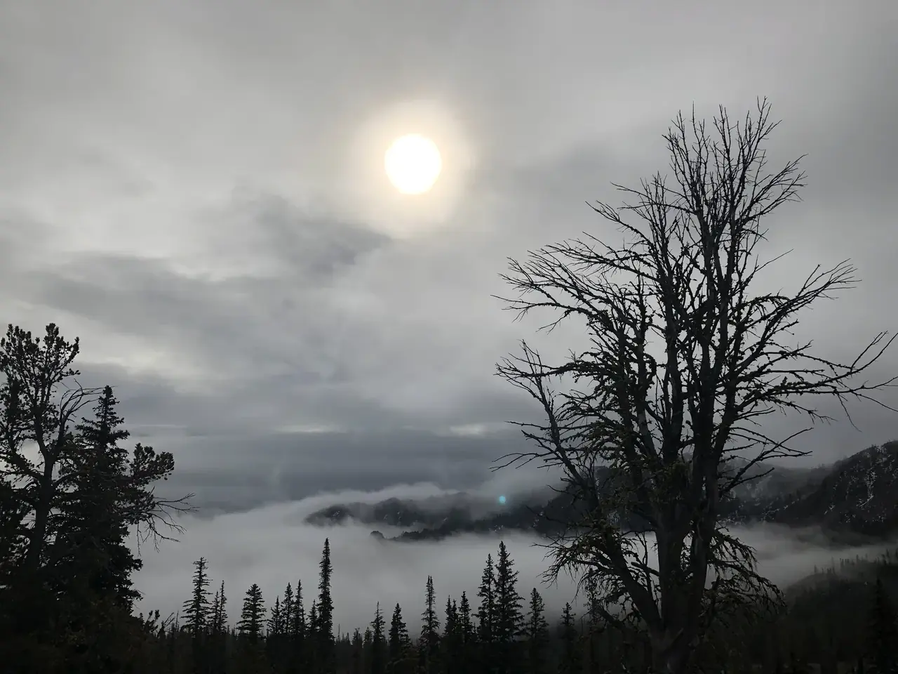

I’ve been away from mountains for ages.

That’s why when there was 40% chance of rain I didn’t turn down the hike invitation (well, partially due to my trust in the organizer Dave too). We met at the North Bend Safeway at 6:30am, and headed out to the trailhead in Dave’s car. The mountain is at the back side of the Enchantments in the Teanaway region. The trailhead was very close to Iron Peak trail, incidentally where I first hiked with this same crew of people a year ago. By 8:44am we were at the trailhead and ready to go. There were four of us, Dave, Trevor, Yulia, and myself.

On our way, I was surprised to learn that Dave didn’t see snow until around 6k ft last weekend at Reynolds Peak. Meanwhile, throughout the drive on I-90, there were very few patches of snow spotted on mountains. The immediate reason was the recent cold but abnormally dry weather in the region (two weeks of consecutive sunny weather in Oct/Nov Seattle). As a result, we didn’t see any snow on the mountain watching from the trailhead. However, we brought our crampons and ice axes regardless, despite the low chance of ever using them during the hike. We also brought our helmet, but ended up not using them either.



The trail itself was very straightforward. Starting from the Stafford Creek Trail, we walked along the creek up a mostly flat terrain for around 3 miles. Most of the time we were walking in airy fogs. It drizzled every now and then. Then we hit the junction Standup Trail and County Line Trail. We turned right to follow the latter. There were some cow poops on the trail. Soon we were on a few switchbacks that winded up to Navaho Pass. Switchbacks were steeper than the terrain before, but not too bad. Once we were up the Navaho Pass, Navaho Peak was to our right within reachable distance. Meanwhile, we also climbed out the fog when we stepped on the pass. The sun came out and wind was blowing in the direction of the mountain. Another hiker came down from the trail with his dog, and complained that he didn’t see anything except the fog. However, we were optimistic that we would have a view once we got up the peak. The trail got steep as we approached the peak. We spotted some twisted tree trunks and a hollow tree, in which we climbed and had some fun time. 1pm, at the time we reached the peak, the sun completely came out and cloud cleared up a bit, giving us some great panorama of the Enchantments backside–Mt. Stuart, McClellan Peak, etc.. In addition, we also spotted quite a few rainbows, one of which was almost a complete circle, with several surrounding layers. The center of this rainbow was the shadow of Navaho Peak, where we were standing upon. In the backside, there were clouds floating and unnamed peaks breaking through those clouds. Three Brothers mountains were watching us from not far away.







We spent a good hour on the top, and decided to tag a small peak on our way back. We believed that was Little Navaho, though it was not marked on the map. The way to Little Navaho was another good but short steep hike. We spotted a cave with gray tailing on the South Side of the mountain, but we didn’t get time to check that out in person.

It was around 3:30pm when we started heading down. Going downhill was pretty uneventful. The sun dropped out of eyesight pretty quickly, not giving us any hint of a sunset view. We walked back down into the cloud and the rain. It was 6:20pm when we finally reached the trailhead in complete darkness.





I wish I had brought half a litter more water with me, as well as taped my heels before heading out. Despite having painful heels, this has been a refreshing hike away from work and travel hassle with good friends.
