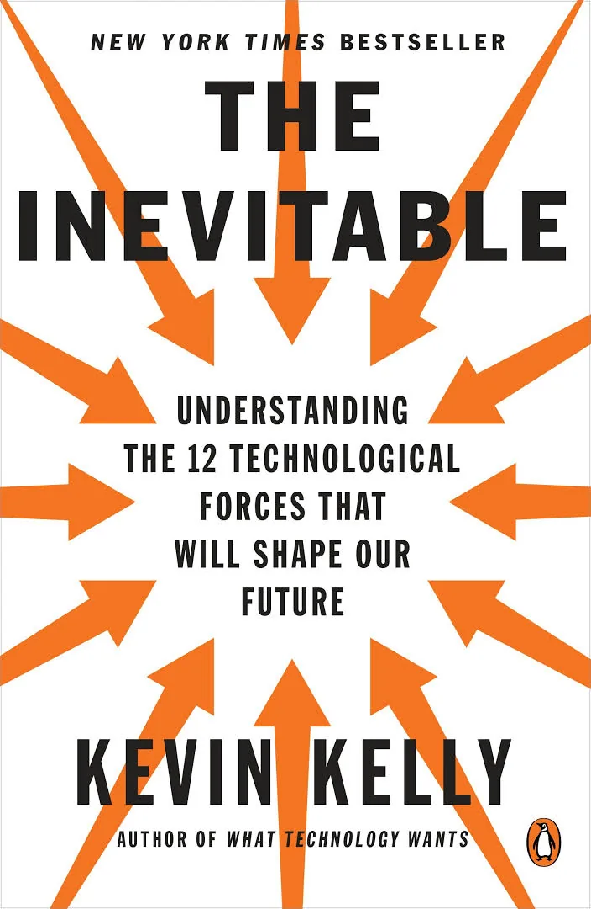

*My blog only represents my own view. It doesn’t reflect my employer’s perspective by any means.*

I listened the book only because Kevin Kelly wrote it. Kelly wrote a book *Out of Control* before, and lots of his prediction turned true in the upcoming decade after he finished the book.

Several interesting ideas from the book included:

The evolution from firm to marketplace to platform. Firm is a place that sells product (e.g. Apple Airpods), marketplace is a place that firm opens up so craftsman aka developers can trade their products (e.g. Apple appstore), and platform is a set of architecture and tools that developers can use for developing their product (e.g. MacOS). I believe the ideal case for building an ecosystem is for a company to own the complete chain. My company Facebook owns the product (Facebook app, which strictly speaking is more of a service/SAAS than a product) and the platform (Facebook developer platform). However, the weakness in our chain is that Facebook doesn’t own the platform on which it runs, i.e. iOS/Android. Hence when the FB/Apple strife started, we would be concerned about how it would impact our app. Facebook did try to build its own mobile phone and OS, which unfortunately didn’t work out. At present though, FB is effectively riding on the wave of Coronavirus and claimed market with its video chat product Portal, featuring its smart camera. If Facebook is able to properly market for the product as well as the [platform](https://developers.facebook.com/products/portal/), this will be a fair opportunity for building a coherent ecosystem within FB’s control.

Everything is becoming a flow. Instead of having discreet written characters or videos, consumers are getting more used to stream flow of media data, such as Spotify or Netflix. With proper tracking technologies, a person’s life can be represented by a flow as well, which contains all kinds of measurement for days activity, such as location, pulse rate, or nutrition intake. This will be FB + Fitbit + Google + Spotify + etc. combined data. Breaking through privacy barriers will be tricky, but privacy barriers will be broken. The recent GDPR/CCPA can be seen as a setback, as it makes data sharing harder in this case.

AI is important. The unexpected idea that Kelly pioneered was collaboration between AI and HI (human intelligence). This touched upon the HCI (human computer interaction) perspective of course, but it also meant better use of AI to help us do our job.

Unfortunately I didn’t hear security got mentioned, and Kelly was preachy enough to sway me to think about pursuing a career in AI. Sorry no. I still love my job in security.
