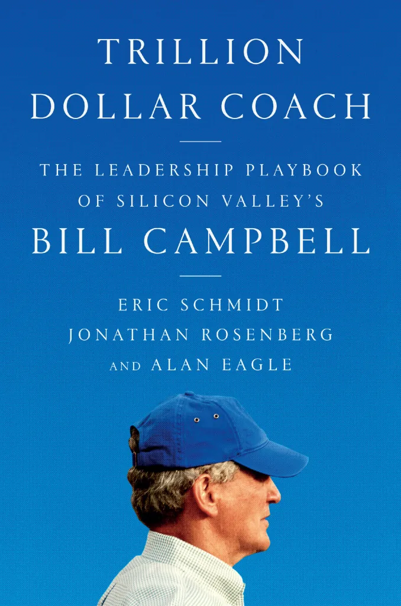

I loved this book a lot, partially because it satisfy my confirmation bias, and partially because I learned something new from it. This is a book for people manager. It tells the coaching principles of Bill Campbell, who’s a football coach turned salesperson and then tech company executives. He coached lots of great leaders in the Silicon Valley, such as Steve Jobs, Eric Schmidt, Sheryl Sandberg, and etc.. He’s a trillion dollar coach since the market value sum of companies whose CEOs/founder he coached were well above trillion dollars.

What makes a good coach different from a good manager? There are dozens of good articles describing the differences, but I think the most distinctive one is that managers oversee projects, whereas coaches support people. Managers make sure projects results get delivered, whereas coaches ensure employees feel supported and growing. The book rightfully pointed out that a good coach had to be a manager first, since a coach should hold people accountable. While with common sense I agree on this, but it doesn’t make much sense since Bill Campbell served as the Intuit CEO while providing coaching to various CEOs/founders in other companies, so there’s no way that Bill could have “managed” his coachees. Taking a step back though, I believe here we are technically differentiating a project manager from people manager, where the former functions more like a “manager” and the latter functions more like a “coach”. In the ideal case two types of managers can properly position themselves and collaborate, but in reality job responsibilities can easily fall through the cracks and cause damage to both the team and the project. I prefer combining those two roles wherever possible. In the book’s words, a team’s coach is usually the team’s manager.

Aside from the project management responsibility of a manager/coach, here are two important traits of a people manager: caring about people, and team first. For an engineering team, engineers are the most valuable resource. “Engineer” without “-er” postfix is an engine, useless machine providing minimum value. A engineer should be treated as a regular person first then a business person. Empathy plays a big role here. The role of a people manager is to:

1. make sure engineers feel supported
2. give them the experience they’d like, and set an area for them to grow
3. think about the team first. decisions should be made for the team’s benefit

One anecdote I appreciated from the book was when Bill Campbell heard a PM (product manager) talking about assigning some feature development work to an engineer in Apple. Campbell said he would throw out the PM if they kept talking about assigning works. Engineers were smart people, who could figure out solutions if knowing the problems. The PM’s job was to relay the problems and concerns from customers to engineers.

One new thing I learned from Bill Campbell was around learning employees’ personal life, or in other words, knowing them as persons. Campbell would always start a conversation in work environment by asking how their coworkers’ personal lives were. This was not just chitchat. Campbell would go to the extent of giving coworkers’ family a phone call to make sure things were going alright if the coworker had some issue with their family for example. This may appear a bit invasive if taken at face value, but Campbell was able to get around it by sincerely caring about and loving others. His father/grandfather-like figure helped build strong team and make coachee feel supported.

Overall great book. I recommend it.
