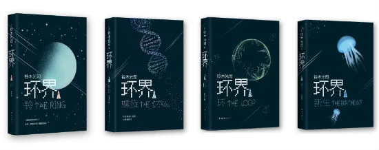

《环界》系列小说更有名的书名是《午夜凶铃》，也多亏了这部经典恐怖电影我才会去听这部小说。然而，小说中没有密林古井和从电视机里爬出的黑长直白衣少女，只有超能力少女山村贞子的死亡复活，以及同化世界阴谋的幻灭。小说大致可以归类为软核科幻悬疑推理小说（?），而其中一二部环绕录像带以及零病毒说的故事颇有可圈可点。不过有评论称之为日本的三体，或是被误解几十年的优秀科幻小说，就实在不知所谓了。尤其是考虑到三四部叙事不断在环界与现实两条叙事线索翻转导致故事说的不太明白。更糟糕的是，叙事在时间顺序上不停地跳转，同时啰嗦地反复诉说相同故事，仍然有很多因果关系最终不知孰因孰果。在此列举几个书中没说明白的现象吧：

1. 高山龙司的复活是阿星从现实世界的分子化的转世，目的是为了消灭环界的零病毒，那贞子为什么还要帮助高山龙司复活？
2. 贞子既然通过超能力能够得知录音带外放事件远山并没有参与，而且二十年后远山依旧深切地爱着贞子，为什么贞子要杀害远山？
3. 高山龙司给阿星打电话时，在现实世界中对应的环界世界，高山龙司是否已经复活？如果是，阿星是如何让环界时间返回以便成为高山龙司复活？如果能够让时间返回，为什么不回到在二十年前阻止贞子？
4. 高山龙司在死前为什么要凄厉的尖叫？
5. 为什么选择高山龙司这个感染了零病毒的人在现实中培育复活？假设这一切都是按照艾略特的计划发展的话，这说明艾略特已经预料到高山会给现实世界带来零病毒（他说这一切都是意外就是说谎）。那为什么艾略特会知道高山一定会带有抗体？

如此这般还能罗列很多，使得三四部实在不忍卒读。
