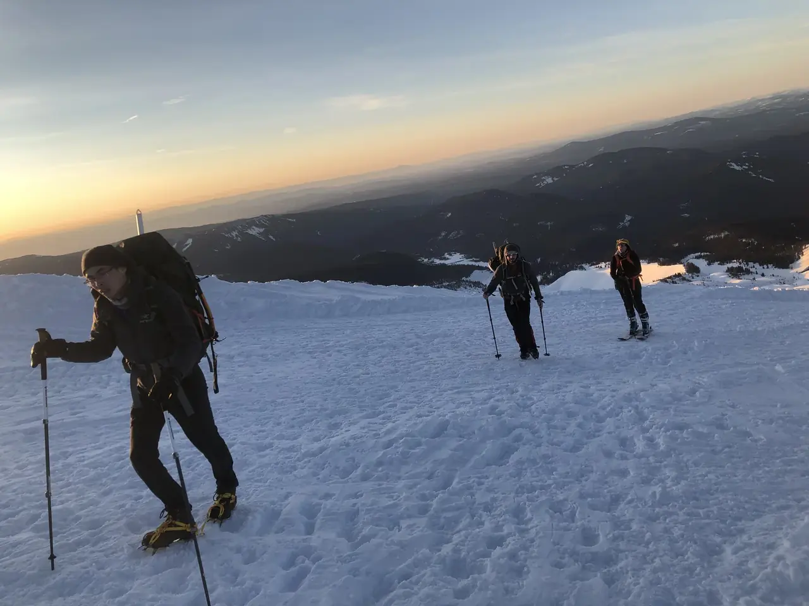

Hood据说是全世界攀爬第二多的山，仅次于富士山。它高达3429米。我们走的是南坡路线，上升大约1.6K米，长度距离大约13千米。我们一行四人：Mel，Trevor，鹏还有我在昨日登上了山顶。



周五晚上开车从西雅图出发前往Hood Timberline Lodge。四点出发，堵车了一个多小时，加上中途向Carl借冰镐和吃饭等等，到达目的地停车场已是晚上十点。收拾好，睡在车里。夜间时刻都有其他车辆来到停车场，高谈阔论不绝于耳，甚至就在我的车窗边。一夜搅扰，半梦半醒之间我浑浑噩噩躺了五个多小时。闹铃声响，起床！打开车门，气温零下，原本空旷的车场已经停了很多辆车。我喝了点热水吃了一个大巧克力玛芬蛋糕，穿好鞋子扣上包，打开头灯就出发了。上到雪地，我，Trevor和鹏直接穿上冰爪，而Mel则装上了了雪板。此时天边的鱼肚白已经夹杂着些鸭蛋黄色了。



路程起始平缓，沿向北偏西，我们路线很快与Hood的缆车线交汇（Hood山脚有一座滑雪场）。我们沿着缆车线攀登，而天色逐渐明朗起来。大约在一个小时后我关上了头灯。很快到达缆车顶部，有一队初学者手持冰镐在缓坡上练习。我们稍作休整吃了点东西。





继续上坡。虽然眼下坡度依然平缓，我还是把一把冰镐从包上卸下拿在手里，同时顺便把头盔带上。逐渐地空气中弥漫起硫的臭味。这是火山喷气孔，虽然我们目前还没看见明显的冒着蒸汽的气孔。西边的一座三角形的大岩石照明岩（Illumination Rock)更加明显。这块岩石在夕阳的照射下会显出耀眼的光泽，然而目前却目光冷峻地俯视着攀登者们。坡度渐陡，我们三在大坑石（Crater Rock）前平缓处停下来休息等待Mel。太阳以及升高，日出前冰冷的蓝白色雪面倒映出刺眼的白光，好在我们早已在七点之前就戴上了墨镜。空气依旧偏冷，温度却很明显比两三个小时前高出许多。



继续上坡，经过一段陡坡我们到达了平缓的恶魔厨房（Devil’s Kitchen）。恶魔厨房可能是我爬过的山里最喜欢的名字之一，第一次听过便印象深刻。我们猜测如此命名，或许是因为这一块平地中有一处裸露出来没有雪的岩石，不断地冒着充满臭味的蒸汽，或许这就是恶魔厨房该有的味道？又或许四周环绕的山壁如同一口大锅的锅沿，而这块散发臭气的岩石正是恶魔正在烹饪的黑暗料理？那我们这些登山者岂非是砧上鱼肉？

很多滑雪者将雪板暂时插在恶魔厨房平缓的雪地里，换上冰爪去爬到峰顶的很陡的最后一段雪坡。Mel也不例外。在恶魔厨房休息了很长时间，温度提升的很快，我即使不活动安静地坐在雪地里，只穿一件单衣也并不觉得寒冷。鹏和Mel有不同程度的高反，都服用了药剂。



出发前往豚背（Hog’s Back），中途经过一个微小的冰缝。豚背是一个小山脊，我们从东坡翻越上去，能够看见西坡裸露的岩石中更多火山排气孔，以及气孔边上的冰缝。两年前三月我和另一名朋友尝试过登顶，但是止步于豚背的顶端，因为当时雾气弥漫下着小雪，天地一片全白，分不清上下坡，最终无奈下撤。



沿着山脊往北上坡，能够看见一串脚印直直地指向由两块大岩石堆起的夹缝，即是最经典的路线珍珠之门（Pearly Gate），有几个黑色的背影在向上缓缓移动。而另一条路线老滑梯（Old Chute），则是向左偏由另一侧的陡坡爬升。我们选择爬老滑梯，因为到达珍珠之门需要跨过或者绕过一段冰缝，而冰缝上的雪桥很薄，不小心可能会掉到冰缝里。



爬老滑梯这一段是全程最难也最危险的了。坡度大约50度，大部分有软雪覆盖，但有些陡的部分除了表面薄薄一层雪底下结着结实的冰块，用冰爪不容易踢入冰中，所以有滑落的危险。而滑落的下方就是火山喷气孔。我尤其担心鹏。这是他第一次爬冰川，对于装备使用都不熟悉，如果滑落我不确定他能够使用冰镐成功刹车。而此时鹏确实也十分疲惫，多次提出要放弃登顶而在原定等我们。



这时Mel施展了高超的鼓励法，同时向鹏提供了药物与食物。经过几十分钟不懈努力，我们总算快要登顶了。这时Trevor已领先一步在顶端等候多时，他笔直的直接爬上去，而我们发现稍微往右偏可以比较平缓地登顶。最终我们从右边走了一个之字形登上顶端。全员登顶！



无限风光在险峰，此言不虚。到达山顶，只见MSH，Rainier，Adams一字排开。山顶的风偏大，但不至于令人望而生畏。Trevor早已在远处等候多时。我掏出了一路背上去的奶酪汉堡大快朵颐。此时不能说晴空万里，却也是攀登Hood的绝佳时间。头顶传来轰鸣声，原来是有飞机低空盘旋。我们向它挥手致意。此时此刻，我们站在俄勒冈州的最高处。回头看看下山的路比较陡，却不至于令人担心。



于是我们沿着原路返回。Trevor和Mel稳步的先下到了豚背上，而我陪着鹏慢慢往下走。下山整体没什么事。到了恶魔厨房，Mel跨上了滑板开始下滑，而我们其他三人则慢慢走着。鹏十分疲惫，我们一路走走停停。最终回到山脚停车场。






