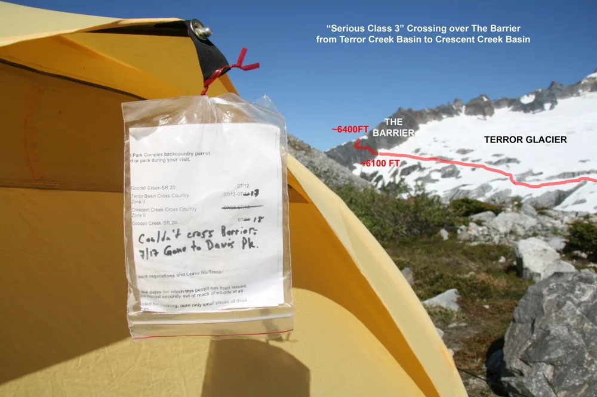
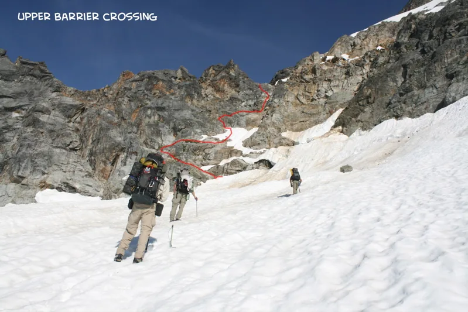
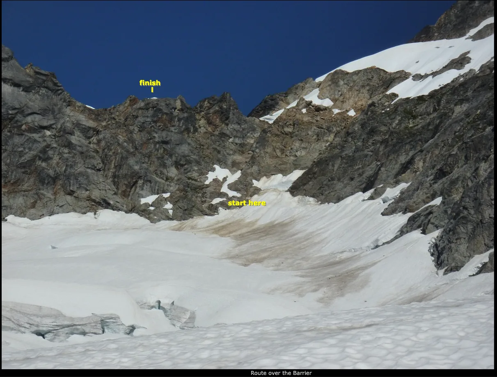

> Shit! Rock! Rock!
>
> Every climber in the Picket Range

我了解的所有Picket登山者几乎都遭遇过落石，而且往往处境非常危险。比如我在18年9月尝试攀登过West McMillan Spire （以下简称WMS），在登顶的陡坡上落石不断，多人都险些被砸中。最惊险是Ian，一个微波炉大小的滚石从他身边堪堪蹦下，把他的手表带蹭断了。如果当时他再靠左20厘米，后果不堪设想。我们很快回撤，走了才两分钟，一块碎石毫无征兆地砸在我们之前的落脚点。17年8月玉婷爬WMS同样惊险，一颗大石向她滚来，她闪身扑倒在雪地上堪堪躲过滚石，然后在陡雪上一路滑坠总算停住。

偏远，艰难与危险向来是Picket山区的名片。僻远的森林里藏着不为人所熟知的山峰，严酷，冷峻，像哲学家石像的额头皱纹，由熔岩与冰川用亿万年时间雕琢而成，令人望之生畏。华州的登山者少有去Picket探索的原因显而易见，而Picket也被成为美国本土最偏僻的山区之一。

但是僻远的山脉不正是攀登的乐趣之一吗？

于是三年后我重返Picket。

人物：栗恺，嘉旎，艺杰，玉婷，丹丹，我

时间：Jul 2 – 5，2021



## Day 1: 敬畏之心

*原计划：Upper Goodell Creek Campground → Terror Basin Campsite → West McMillan Spire → Terror Basin Campsite*

*实际：Upper Goodell Creek Campground → Terror Basin Campsite*

起了个大早，从西雅图开往[North Cascades 信息中心](https://www.nps.gov/noca/planyourvisit/hours.htm)。七点中心开门拿到露营许可证，我们大约八点到达Upper Goodell Creek Campground开爬。

一开始路上杂草长满了路边，踏过一些干涸的河床，趟过湍急的溪流。虽然要脱鞋，所幸水流浅而不冰冷。路上时不时可见鼻涕虫和多足虫。这样子走了大概4mi，来到一处岔路口，路边放了两处cairn（用以指路的石碓）。cairn右边前往WMS，而直行则是前往Terror的路上。我们在此歇息。栗恺提出直接去爬Terror，这样就能够直接跳过此次爬山的难点Barrier（下文提及），后来拗不过我的任性，大家按照原计划沿右边岔路开始爬升。



原本平坦的路突然有了坡度，而且越来越陡，很多地方需要绕过倒塌树木，或是从底下钻过，或是从树干上跨过。游客稀少加上路径缺少维护，我们时不时失去了方向，花了不少时间去找路。很多陡的地方需要手脚并用，或是握住上方的树干或树根，或是抠住灰泥中显露的汉白玉石块。树林挡住了山风，天气闷热，包裹沉重，我们很快大汗淋漓。我脱了上衣，拆了长裤腿，只穿着短裤爬山。不幸中的万幸（至少对我来说），相比于光着膀子的我和光着腿的艺杰，蚊虫更青睐穿着一层薄纱的玉婷。丹丹的解释一语中的，我和艺杰裸露的皮肤是空阔的广场，玉婷的薄纱是停车场，一个一个孔洞就好比停车位，反而让蚊子更有迹可循。我们都喷了防虫药水，不过似乎是杯水车薪。



终于出了树线。其时山雾弥漫，空气中有淡淡的烟味，据说是西海岸的山火已经开始燃烧。在低海拔时我们只能看到一层淡淡的白雾，不想爬到了树线上，烟雾反而越来越浓。原本应该令人精神振奋的远山雄景完全被白茫茫所遮蔽。我们走走停停，躲着蚊子踏着雪，来到了Terror Basin之上。在盛夏及暮夏时分，从这里要下到盆地往往要走一个危险的碎石坡，然而此时碎石坡被雪覆盖着，所以只要戴上头盔拿着冰镐稳定地下坡，不必担心落石。原本路上只有我们一队人，在这里看到另一队，踩着我们的脚印追了上来。



到了盆地露营点依旧大雾弥漫。这时已经将近五点。出发前我们预计要下午两点到达露营地，回头看来未免过于雄心壮志。用玉婷的话讲，是我们对Picket没有敬畏之心，当然Picket要给我们找点麻烦。营地有充足的冰雪融水。我们安营扎寨，收拾晚饭，准备第二天爬Barrier。

## Day 2: Barrier Encounter

*原计划：Terror Basin Campsite → The Barrier → Crescent Basin Campsite*

*实际：Terror Basin Campsite → almost to the Barrier → Terror Basin Campsite*

The Barrier 名副其实，横亘在从South Picket的东边Terror Basin往西边Crescent Basin的路上。它与Degenhardt相连，相当于南部的山脊，也是一面难以翻越的高墙。网上对于Barrier的记述非常少，首先因为Picket本不就是热门爬山地点，其次去Picket大部分人都是冲着WMS去的，很少有人像我们这样traverse。我在网上唯一能找到的资料是几张图，两张是从东往西翻越Barrier墙面的路线照片，一张是记述Barrier翻越路线海拔的照片。翻阅Barrier有高低两条线，我们收集到路线信息应该是低线。我们的计划是前往Barrier到达对应的海拔，然后对照照片寻找路线。

- 
- 
- 

我能找到关于barrier的有限资料

因为低估了难度，加上Terror盆地的晨雾，我们十点才把帐篷拆掉出发。当天有两队登山者先我们出发，一队去爬WMS，另一队去爬Inspiration Peak。



眼前是一个正在逐渐崩塌的河谷。河谷下暗流涌动，河谷上是一座雪桥。我们决定一人一人通过，这样可以避免同时给雪桥太大压力导致崩塌，同时如果有人被水冲走其余五人可以进行救援。雪上有几处湿雪崩塌陷的迹象，踩进去雪非常软很吓人。幸运的是，我们当天与次日穿行都没有出现问题。



到达河谷对面，我们决定爬升到一定高度，然后向西穿过雪野到达Barrier底。这条线在上升途中与WMS的登山路线重合的，所以我们基本可以按照前往WMS的GPS路线行进。然而当我们开始向西（向左）穿越时，看到上方一个流水形成的瀑布，瀑布上端的雪已破碎，露出湿漉漉的岩石，而瀑布下方的雪是流水上的一个雪桥，经过前两周华州高温，我们很难确定是否能够通过。于是我们向更低处走，结果又看见一个融雪瀑布在我们上端。我们不愿意冒险走瀑布流经的雪桥，于是往更低处走，直到看到一个雪完全融化水流露出来的岩石上，翻过它，然后scramble一小段，到达下一个雪地。





于是我们沿着雪地往西，尝试寻找上升的路线。途中还有几条小的融雪水流，但是流量小危险不大。很快我们走到一个悬崖边上，继续往西已经走不通，而往上是一个class 3的干净的slab。我们确定每个人都可以往上爬，于是大约沿着这块大岩石爬了约200ft。途中栗恺很谨慎地提醒所有人回头看，保证上来的路我们能够下得去。同时我们定了回撤时间3点。



到达slab上端有很好的雪可以走。所有人松了一口气，踩着雪上升。我们看到一片大的融雪，大片的雪在水中崩碎。融水覆盖着湿漉漉的岩石，然而要继续前往Barrier，我们要么走过湿漉漉的slab，要么进入Terror Glacier。在出发前我们就合计过，要避免走冰川，这样就可以不用带冰川的保护与救援装备。眼前的冰川已经形成很多裂缝，目测深可达五米，应该不会造成生命危险，但有掉进冰缝受伤爬出来的风险。



我们面临两个选择，一个是继续翻越Barrier，如果当天不成功，晚上要临时找一个露营地点；另一个选择是回到Terror盆地，第三天去爬WMS。我们选择后者。



回到Terror盆地营地正在休整，突然背后响起了直升机轰鸣声。只见一架直升机从East McMillan Spire上飞过，向着Barrier飞去。我的第一反应竟然是“如果这飞机能带着我们翻过Barrier就好了”。眼见直升机在Barrier方向消失，几分钟后盘旋第二次，第三次，最终停在Chopping Block上，我们才认定那是救援直升机。我们猜测是救援去爬Inspiration Peak的那帮人。不久，出发去WMS的队伍回到了营地。他们看到我们相当惊奇，毕竟我们早上收拾帐篷现在就不该在这儿了。我们没完成目标跑了回来，和对方说话多少有些尴尬，不过对方连Barrier都没听过，我还是暗暗爽了一下。



再次安营扎寨，不表。



ps: [actual GPX](https://www.gaiagps.com/map/?loc=15.9/-121.2833/48.7624&pubLink=y0MU34Hc2mtm5wFEjmY7PqQ8&trackId=486afb4d-f4ad-4221-9793-b776de86157a)

## Day 3:十万年前的星光

*原计划：Crescent Basin Campsite → Mt Terror → Chopping Block Ridge*

*实际：Terror Basin Campsite → West McMillan Spire → Terror Basin Campsite*

我们一早六点半起床，烧烧水吃点早饭，收拾好已经将近八点。登顶的一天反而是四天中最轻松的一天，因为不需要携带露营和攀岩用具。先我们半小时有一队人出发了，所以我们只需要随着他们的脚印即可。一路轻松写意。路上有很多融雪水流，需要喝水随时接就行。到达inspiration peak与WMS之间的山谷，有一个陡的雪坡。三年前我就是在这儿遭遇落石，而玉婷四年前也险些被落石击中而滑坠。如今这儿基本完全被雪覆盖，所以只要西边的岩壁上没有落石，我们的风险就很小。



在上坡途中我们带上的头盔，因为在平地上没想起来穿冰爪，而且前一拨登山者已经在雪坡上踩出脚印，我们都有穿冰爪就上去了。石头坡上基本是No fall zone（摔即死）。向东可以看到山脊东边的Azure Lake。由于后面一路scramble不会再有雪，很多人换上了approach shoes。

scramble的路上应该沿着土坡向上，能找到一个cairn。我们上坡路上错过了这个cairn，绕了点路。因为要防止我在其他人的上方踢下碎石造成危险，我脱离队伍更靠左边走，似乎误打误撞到了该走的路上上。大部分时间手点与脚点都很好，偶尔有些短暂的class 4的动作，但exposure基本处于合理范围之内。











到达峰顶。看到北面的Challenger，更远的Luna是远远的山头，还有近处的Inspiration Peak, Pyramid, Degenhardt, 以及我们原本想去爬的Terror。Terror从我们这个角度看非常坚挺，笔直的山峰直入云霄，想来从东边的山脊爬有相当难度。之前就看过一个人写过的记录，说是5.6爬着像5.8，非常可怕。路上还听到远远的有石头崩碎还是冰雪崩碎的声音。



这次在路上因为比前一天上的更高，我们能更好的观察barrier crossing，加上有了艺杰的望远镜，我找到了对应图片上的Barrier翻越点。原来图片上的示意图是在更高的翻越点，而6100ft的海拔是更低的翻越点，这两个本就不是一处，我们按图索骥当然无功而返。



到高山上（一般是4500 ft以上），如果拉屎是不能埋起来的，得装袋子里背下山，所以很多人不愿意在高山泄粪，一方面是背在背上累，更重要的一方面，是总会担心屎袋子会漏在包里。玉婷之前没有背过，但才过了两天似乎就驾轻就熟了，因为我回到营地在石头上研究岩壁时，朦胧中听到远处丹丹和玉婷的对话：

— “丹丹你拉了吗？”

— “我拉了！”

— “（兴奋地）我也拉了！”

古人言诚不欺人，所谓饭要一口一口地吃，屁要一个一个地放，屎要一包一包地装。当然最让人佩服的还是栗恺，憋了四天坦然自若，下了山依然胃口大开吃了我的两倍。

迷糊睡到午夜，看到帐篷壁映照了一个模糊红光照耀下魍魉的黑影，起来放水，原来是艺杰刚拍完星空。我和丹丹拉开帐篷门看星星，一颗流星飞坠，留下天空的一闪。

远远的银河有十万光年，却注定在这一瞬被我尽收眼底。难道十万年前银河系边缘的星光辐射向十万年后我所在地球一隅时，就早已注定了此时此刻吗？在十万年后，还会有另一个生物看到此时此刻的星光吗？时间脱离了空间没有意义。我的存在只是大山的一瞬，然而在这一瞬之间，我看到了从四十亿年前地球形成时，不，更早，从时间起源宇宙坍缩到如今一切的一切，这些都只是一个剪影，投射在头顶明媚的星空与冷峻的山峦上。

我数到第五颗流星后拉上帐篷。黑空中银色的时间线就这样消失了。

## Day 4: “Bushwacked”

*原计划：Chopping Block Ridge → Upper Goodell Creek Campground*

*实际：Terror Basin Campsite → Upper Goodell Creek Campground*

一般下山的路都会走的很慵懒，没想到我们这次下山出发比前三天都要早。追究原因，艺杰第一天豪爽地答应请大家吃豆捞，让我们念叨了一路，总算要回家了，考虑到开车路上的时间，我们决定alpine start回家。Alpine start一般指为了攀登高山需要早早起床，早则午夜一点，晚则凌晨三点。然而栗恺强烈反对，最终我们决定五点半起床七点出发。

一路平安无事，没什么值得一提，不过既然说80%的事故都发生在下山的路上，没事也就是好事。

从Terror Basin爬上大雪坡进入高山草甸。三年前的九月草甸上结满了甜甜的野蓝莓，是我辛苦爬完三天山的最大慰藉，可惜这次尚在开花未曾结果。一路穿梭回到树线。我自认为在开阔地还挺记路的，但一进树林就晕头，多亏伙伴们火眼金睛带领回到了来时的路上。





一路Veggie belay下山，偶尔会belay时veggie断了。一路披荆斩棘，有一个专业说法，叫bushwacking，不过我们这路上的经历似乎用“bushwacked”更加确切。丹丹发明了成语“出其不意必自毙”，差点在我身上应验：在一个陡坡我不想慢慢蹭就直接跳了下去，险些给我崴了脚。总算回到了有两块cairn的分叉处。再后面的路上，有鲜红的thimble Berry，浆果柔软酸甜，是我最喜欢的野果。有玛瑙蓝的溪水，在远处唱着难懂的歌谣，若是有这句歌词就很适合我当时的心境了：

在山泉水清，出山泉水浊。水清濯吾冠，水浊濯吾足。

### 后记

最终我们也没有吃成豆捞，因为要排队，结果是韩国烤肉。

回到文明社会我们得知，直升机救援的是一队去爬Terror的队伍。一个登山者从岩壁上下撤时被砸伤了腿，情况不糟糕，但同队的护士坚持这个登山者用卫星救援。直升机停在Chopping Block的同时这一队伍撤下了岩壁，最终全队人成功搭乘直升机脱离山地。如果按照原本计划，我们会在后一天同样爬Terror，不知道会不会也遭遇落石受伤。

下一个目标？去Northern Picket看看吧，Luna Peak和Mt Challenger都是很棒的去处。
