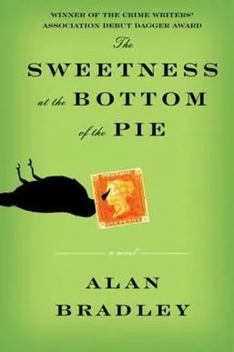

I found this novel by accident while scanning through a list of available audio books in my local library, but it turned out a quite enjoyable read. The plot was around a 11-year old girl Flavia de Luce clearing her father from a murder investigation through her own independent investigation. The plot was fine, as I mostly didn’t get surprised, and I don’t really know if the author spent much time on plotting anyway. However, the depiction of the protagonist Flavia was the most excellent. Flavia’s monologue and pranksters cracked me up throughout the book. There were full of entertaining witty small things. My favorite was when Flavia asked Investigator Hewitt his choice of symbol for Flavia in the police confidential journal, since the journal wouldn’t have people’s name in plaintext for secrecy. The answer was “P”. It should be hard to guess that “P” was for poison, given Flavia’s talent and passion for chemistry and poison in particular.

This was just so sweet.

===

5/5: I love it!

***4/5: I really like it!***

3/5: I like it.

2/5: Fine.

1/5: Not recommend.
