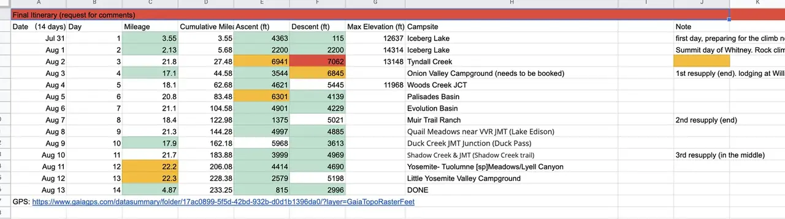

< Day1 (July 30 之前）

John Muir Trail (JMT，约翰穆尔步道）是美国很著名的长距离步道，位于加州中部的High Sierra（内华达山脉），全长211 mi（340km），海拔变化47k ft（14k m，大约1.6个珠峰高度）。它由南端的Whitney峰顶（惠特尼山，美国大陆最高处）连接到北边的Yosemite（优胜美地国家公园）。自从2020年徒步走完[Wonderland Trail](https://aozhang.blog/2020/10/05/wonderland-trail-in-7-days/)后，我就一直心痒想再走一段Thru-hike (长距离徒步）。JMT长度正好，而且难度相对简单，所以我把目光锁定在它的上面。

JMT有两个方向。大部分徒步者都选择南下，将最后的Whitney美国大陆最高点作为全程的高潮结束旅程。我则选择北上，因为：

- Whitney的许可证比Yosemite的好申请。
- 北上意味着大部分时间阳光在身后不会刺眼。
- 从Whitney出发可以先攀岩上顶峰然后一路北上。如果南下要走攀岩Whitney的线路则需要绕路。

你没看错，我们计划攀岩上Whitney。计划中我们有四人，Lena，彭畅，婉莹还有我。我们四人会走Whitney East Buttress线路上山（5.7, 11 pitches）。我和Lena一个绳组，背着包爬，而彭畅和婉莹另一个绳组。到了峰顶PC和WY会把我们的攀岩装备背下山。他们两飞回西雅图，而我和Lena开始走全程的JMT。

JMT平均需要20天左右的时间完成，但是Lena没有这么多时间。经过不断的压缩，我做出了一个13天的行程，大致意味着我们需要每天走大概20mi，上升下降常常在4K ft以上，这导致的结果是我们的容错率非常低。

同时在出发前我们意识到几个挑战：

1. 高海拔：JMT全程基本都在三千米以上。这是大多数人有高原反应的高度。即便排除高山脑积水与肺积水(HACE, HAPE)这两种严重的高反，很多人也都会有胸闷气喘以及走路无力感，更何况背着重包攀岩。记得之前和朋友去攀登Mt. Rainier（雷尼尔雪山），一个朋友在帐篷里就说”等我歇口气再喝水，喘的很“。不幸我们四人除我之外都在三周前同时得了新冠。因为新冠会影响到人的肺，所以我们很担心对于高海拔的适应。
2. 山火：出发前的优胜美地南部的Mariposa城市正在起大山火，按照媒体报道是可以永远摧毁优胜美地的级别，所以空气质量特别不好。
3. 速度：这种一天20mi的速度以及上升下降的海拔本身就是一种巨大挑战。

不过箭在弦上，走。
