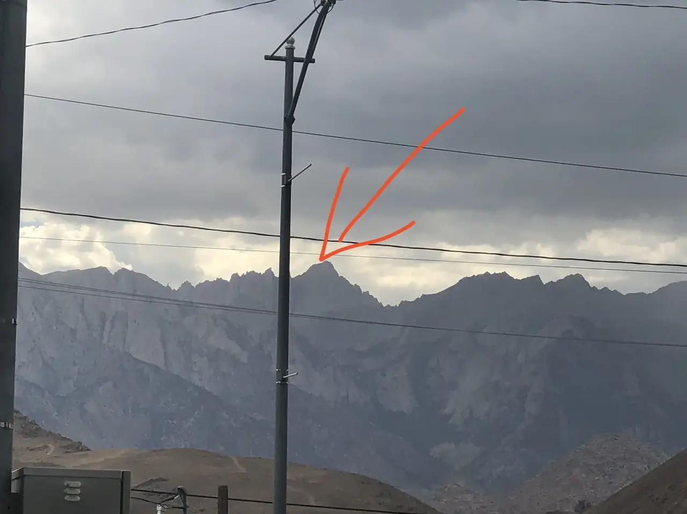
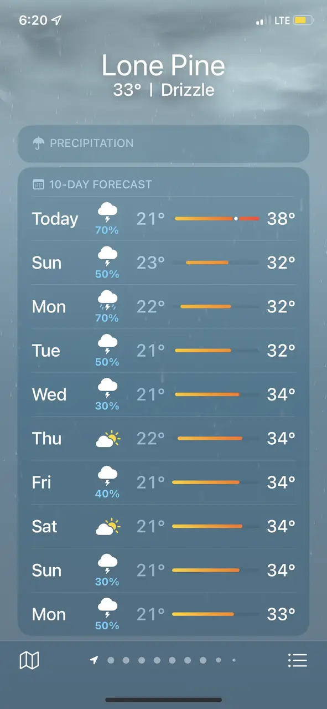

Day 0. Jul 30,2022 SEA → LAX → Lone Pine (1400 mi)

早上六点多的飞机。Lena匆忙赶到机场，又遇到了安检长队，差点错过飞机让我们的计划胎死腹中。匆忙中Lena错拿了朋友的睡垫，不想给后来埋下了伏笔。落地洛杉矶，有彭畅和婉莹为我和Lena接机，他们两已经提前两天到达了LAX玩了一会儿了。我们路过一家中国餐馆饱餐一顿，路过了REI补充了点装备。洛杉矶天气干燥炎热，随着车向北行进，空气愈加燥热。然而天气预报中Whitney将有多天雷雨。若是普通的降水，大不了在岩壁上演湿身诱惑，忍忍就过了。但是若在电闪雷鸣中登凌绝顶，不免有种找劈的舍我其谁的英雄慨叹。听彭畅说一个朋友便是三年前同样登顶Whitney，在半山腰攀登途中遭遇雷电，而后攀岩用的塞子嗡嗡作响，而且头皮发麻。虽然最终有惊无险，但是真是遇到这种状况当真是不可能及时下撤得到有效庇护。

因此我们路上考虑了多种攀登方法，一种是像原来安排的一样，大致归结到几个问题：

- 我们是不是要carry over（要不要背着重包去攀岩）
- 走哪一条线下来：mountaineer路线短而直接，hiking路线长而平缓。前者但是在雨水中石头可能不稳，有滑坡的风险，后者则需要注定要carryover
- 中途是不是要晚上在山上露营

最后决定在Whitney版图中的树线之下一个地方叫做Lower Boy Scout Lake的地方露营，挨过一个晚上的电闪雷鸣，而后凌晨出发，在正午前登顶，在下午打雷前冲下山。

四个小时的车程后到达Whitney以东13mi的一个叫做Lone Pine的小镇（孤松镇）歇脚。刚刚开进小镇，一场豪雨不期而至，一下子泼灭了所有的暑气。雨很快停歇下来。我们在小镇周围一个气象站门口看远处的Whitney高耸的山尖藏在灰浓的云中，不详的念头在脑海里酝酿。

*乌云笼罩下的Whitney山顶*

在汽车旅馆里我们打着绳结消磨时间。攀岩者对绳结有种特殊的感情，看见一个特殊的绳结总会问个究竟，直到自己能够打的滚瓜烂熟才会罢休。

*求内心阴影与云层阴影孰大*
