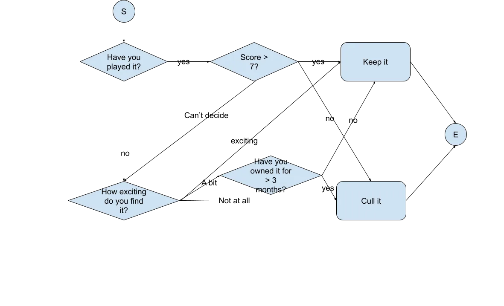

I’ve spent much of the past 3 years playing board games. A common issue with board gamers is that we have too many games. While lots of fellow gamers complain about the shelf space their games take up, personally the biggest problem with my collection is the mental space my collection weigh on me. I found my mind frequently wandering into the land of “what games should I play next?” or “when am I going to start that 50 hours+ long campaign game” and eventually to the frustration that I couldn’t focus on getting stuff done.

To be fair, there’s nothing special about board games in this case. It’s a general symptom of obsession, or more accurately, addiction. One solution is to keep the collection size down–a more manageable collection size should make it easier to unweigh my mental load correct? Hence I made this following algorithm for culling games:

A few things to note:

1. I’m okay to cull a game that I haven’t played. If a game is in my collection but I’m not excited to play it, it essentially is an unused resource to me and others may be better off getting it from me.
2. The 3-month period is an arbitrary period, chosen for convenience.

In case you are interested in my collection, here’s a more or less accurate list of it. <https://boardgamegeek.com/collection/user/aooz>
