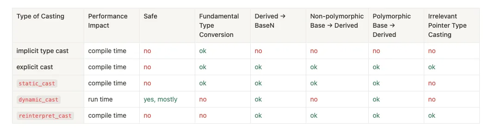

In C++ we usually deal with 6 types of type casting:

- implicit type cast
- explicit type cast
- `static_cast`
- `dynamic_cast`
- `reinterpret_cast`
- `const_cast`

For the sake of my discussion, I’ll exclude `const_cast` upfront. `const_cast` sets/unsets the `const`-ness of a pointer, and it has limited security implication.

For the remaining 5 types of casts, it’s useful to put them in a table for easy reference:



Now let’s dive into each:

## Implicit Type Cast

Implicit type cast supports fundamental type conversion. For example, you can implicitly convert between integer based types such as `char`, `unsignted int`, etc.. Caveats here are several, and come with security implications. This gets especially complicated when it comes to arithmetic conversions, signedness, floating points and long types. For simplicity, I’ll mark this out of scope and redirect readers to just avoid doing this.

## Explicit Type Cast

Explicit type cast is truly wild west. Just don’t use it.

## `reinterpret_cast`

`reinterpret_cast` is useful for pointer manipulation. It’s very powerful and prone to abuse as it supports:

- type casting between pointers to irrelevant classes
- type casting between integers and pointers

## `static_cast`

Enters `static_cast`. At compile time, it has type information from the compiler, so it’s able to tell irrelevant class type pointers apart. Apart from that though, developers are still left on their own to handle class inheritance correctly.

The biggest benefit? Type checking happens at compile type, so it doesn’t do any runtime type check and hence incur no runtime cost.

## `dynamic_cast`

This is the safest you get among all the choices. It relies on RTTI (RunTime Type Information) to work. It will also correctly tell you whether a polymorphic downcasting is successful. However, it also comes with downsides:

- it inserts additional CPU instructions, hence incurs runtime cost
- it doesn’t handle diamond inheritance situation
- it only supports `public` inheritance

## Type Confusion

As security professionals, we care about type casting because type confusion is a legitimate vulnerability that’s shown in cause real-world attacks. There are numerous ways this can be exploited, such as

- unsafe type casting: for example, `static_cast`-ing incorrectly between class pointers can lead to the program assuming that certain class fields’ existence, whereas in reality those memory addresses can be pointing to other data. Hence it can cause memory corruption.
- unions: `union` is a language struct that can make data of different types to coexist in the same memory location. Confusion between types will cause a program to interpret the union data incorrectly.
- v-table: C++ supports polymorphism through virtual function tables (v-table). As `dynamic_cast` isn’t effective for correct polymorphic type casting, it’s prone to exploitation.

## Reference codes for each casting

Below I included codes for illustrating each conversion scenarios. For simplicity I’m using only one type each for illustration. If you wanna play with other types of casting, just substitute the type cast with the desired casting type.

### Fundamental Type Conversion

Implicit Casting

```cpp
#include <iostream>
using namespace std;

int main() {
  int c = 40;
  char d = c;
  cout << d << endl;
  return 0;
}
```

### Base → Derived

`reinterpret_cast`

```cpp
#include <iostream>
using namespace std;

class Base {};
class Derived: public Base {
  public: int a = 999;
};

int main() {
  Base b;
  Derived *d = reinterpret_cast<Derived*>(&b);
  cout << d->a << endl;  // This compiles, but what does it output?
  return 0;
}
```

### Non-polymorphic Derived → Base

`static_cast`

```cpp
#include <iostream>
using namespace std;

class Base {};
class Derived: public Base {};

int main() {
  Derived d;
  Base *b = static_cast<Base*>(&d);
  return 0;
}
```

### Polymorphic Derived → Base

`dynamic_cast`

```cpp
#include <iostream>
using namespace std;

class Base {
public:
  virtual void dummy(){};
};
class Derived : public Base {
public:
  int a = 999;
};

int main() {
  Base b;
  Derived *d = dynamic_cast<Derived *>(&b);
  if (d != 0) {
    cout << d->a << endl;
  } else {
    cout << "incorrectly doing downcasting" << endl;
  }
  return 0;
}
```

### Irrelevant Type Casting

Explicit casting

```cpp
#include <iostream>
using namespace std;

class A {
public:
  int a, b;
  A(int v, int s) : a(v), b(s) {}
};

class B {
public:
  char c, d;
};

int main() {
  A ptra(1, 2);
  B *ptrb = (B*)&ptra;  // still compiles. This is wild west
  cout << ptrb->c << endl;
  return 0;
}
```
