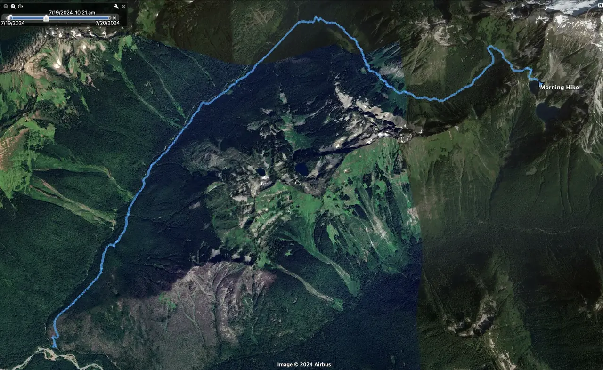
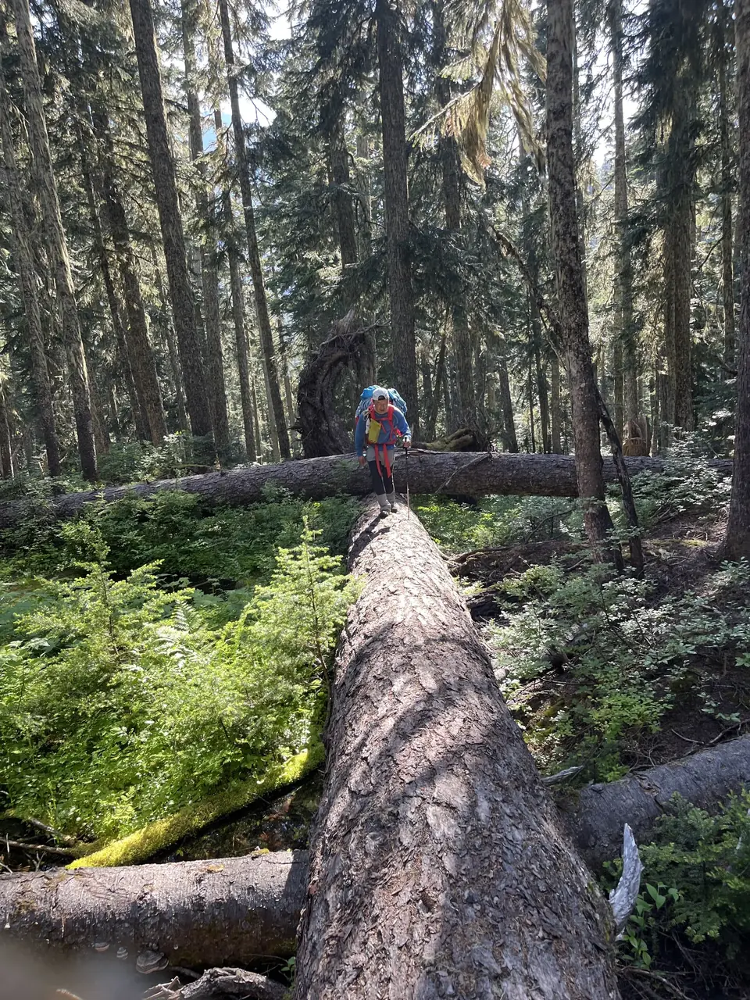
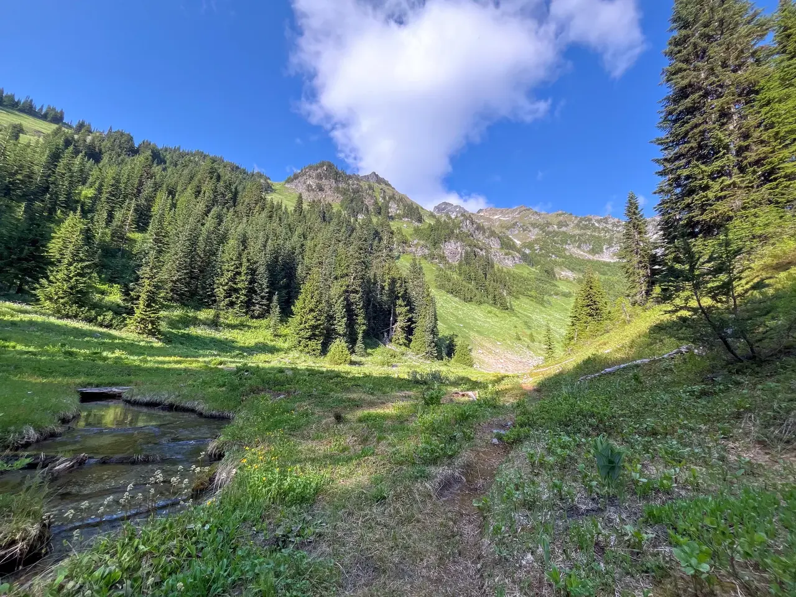
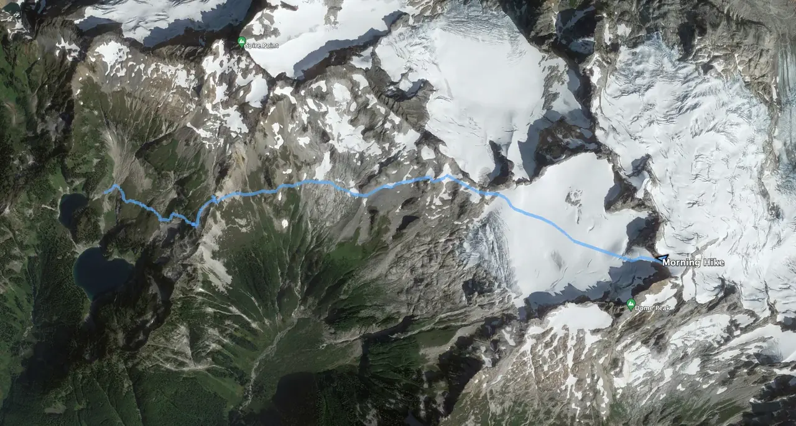
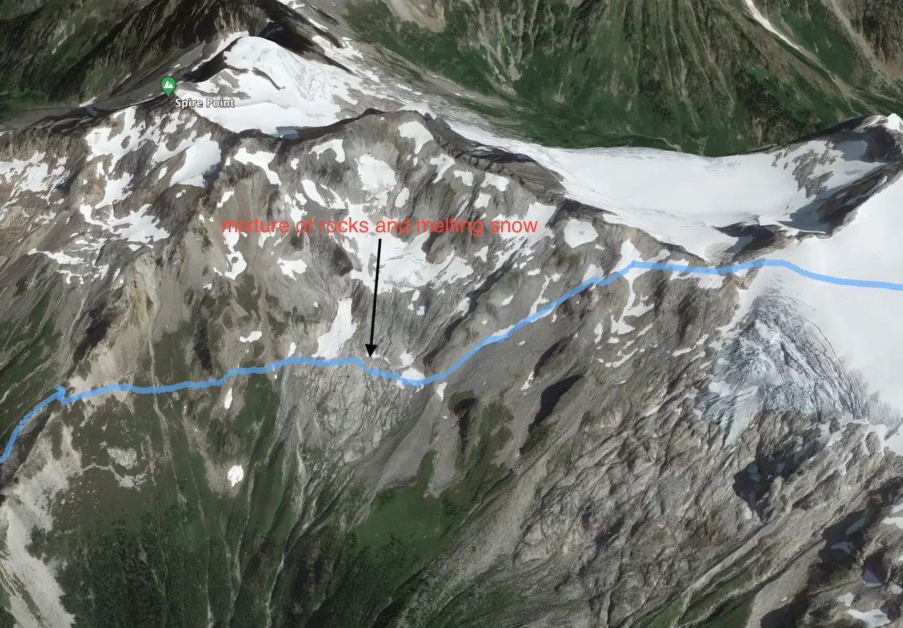

“*We found your tent in a bergshrund*” — two nice mountaineers

My friend Frank and I had one thing in common: we loved scrambling remote mountains and navigating the shit out of them. One day he fabricated the genius idea of climbing Dome/Sinister/Gunsight Peak in one go. This sounded very appealing because I had not the slightest hint of where those mountains were.

So off we went.

## Day 1: Why am I climbing this shit?

*Downy Creek TH → Cub Lake*

We were about to embark on a true alpine adventure, which included glacier travel, rock climbing, bushwhacking through dense vegetation (Cascades-style), and scrambling over loose rocks. All of this required carrying heavy gear, and my pack weighed in at an whooping 43 pounds, with a base weight of 31 pounds. Frank, on the other hand, managed to keep his pack at 41 pounds while also maintaining a compact setup.



We set out from Downy Creek Trail in the morning. The trail initially followed the creek, which meant there were plenty of water crossings—and, unfortunately, plenty of bugs. Looking back, I realize I should have brought an empty water bottle instead of my fructose-rich apple juice; it would have been better for both my legs and my metabolism.





The bushwhacking was brutal at times, comparable to the Pickets, and ranks among the top five worst bushwhacking experiences I’ve had in the Cascade Range.

Overall, navigation was manageable, as the trail was faintly marked most of the time. In areas with dense fallen logs, we had to use GPS to find our way back. This turned out to be fun, as we navigated through mazes of fallen logs while following the general direction.

At an obvious junction between Downy Creek and Bachelor Creek, the trail became steeper. There was a flagged trail alongside the old one, and we chose the flagged path, which was easy to follow thanks to the pink ribbons marking the way.

It had been a long time since I last needed to pack a bear canister, so long that I had forgotten how it feels to have a hard metal cylinder pressing against my lumbar. It hurt with every step until I finally padded it with my down jacket against my waist. While that eased the ache, I was still panting and sweating. Unlike the bear canister, the hot weather couldn’t be adjusted, and it took a lot of effort to bushwhack uphill with a heavy pack in these conditions. The trail had plenty of muddy spots, and unfortunately, I slipped in one, landing with my backside fully immersed in a small, dirty pond. It wasn’t fun.

On an encounter, we ran into a party of two coming the opposite direction. They were on their last day of Ptarmigan Traverse. We also saw two other kind souls working on the trail maintenance. Aside from those times, we didn’t see other human on that day.



Eventually, we reached the alpine meadow and descended a steep dirt path to Cub Lake. The alpine flowers were in full bloom, painting the landscape with vibrant colors. The path was lined with vivid reds, purples, and yellows, creating a dazzling sight that made the journey down to the lake truly breathtaking.





Exhausted, we unpacked and set up our tent at the lake.

## Day 2: Glacier Peak, Forest Fire and Frank on Dome

*Cub Lake → Dome-Chickamin Col → Dome Summit*

That night was unrestful. There was so much condensation in my tent from the warm night that droplets were dripping onto my face at night. My watch logged about 4 hours of sleep when our alarm went off at 4am, and I thought even the 4 hours was overestimating. It also logged an HRV of 28ms (my normal range 38-50ms) and told me that I was too tired.

Yeah. I was aware.

We started off hiking around 5am, along a faint path then onto Itswoot Ridge line via class 3 scramble on wet rocks and mossy dirts. Fortunately the scrambling part, albeit annoying, wasn’t too long. Once up the ridge line, we met three parties. One of them decided to just take a zero day on the ridge to relax. One of the party was cowboy-style camping on the ridge line (sleeping without a tent).





The ridgeline is where the Ptarmigan Traverse and the climbing route to Dome, Sinister, and Gunsight Peak diverged. While the Ptarmigan Traverse followed the ridge upwards, the Dome climbing route descended along the ridgeline, leading down into an alpine meadow. As the route reached a boulder field, it became faint and eventually disappeared into a mix of snow, loose slabby rocks, and occasional scree. Meltwater flowed beneath the snowfield, and we punched through it a few times.

The mixture of snow and rocks eventually gave way to continuous snow fields, and then to the Dome Glacier. We roped up at the glacier. The snow was broken up with crevasses, but didn’t demand much detour to get around.



We saw Dome Peak looming ahead, but decided not to go for the Dome traverse route due to heavy pack, and the extra fatigue lingering from day 1.





We reached the Dome-Chickamin Col in the early afternoon. The last stretch of the climb involved steep snow and scrambling over loose rocks. Fortunately, it was warm enough that we didn’t have to deal with icy conditions on the snow. There was a prepared campsite at the col, and after dropping off our tents and extra food, we headed for the Dome summit.

The push to the Dome summit from the col was straightforward, consisting mostly of trekking on steep snow with a small amount of rock scrambling near the top. The ridgeline snow was a bit exposed, but once we reached the rocks, the exposure increased significantly, especially in the last 10 to 20 feet. Frank scooped over with almost no places for protection, while I decided to play it safe and watch. A gut feeling warned me not to continue, and I was happy to heed it.



While setting up the summit belay though, I spotted a column of white smoke rising between the summit and Glacier peak.

-“Oh woah, look at that fire! Gotta be Pioneer fire”

-”Wait no, that fire looks new.”

-”Ah crap, it’s a new fire starting somewhere. The direction also isn’t Lake Chelan”

I pulled out my GPS and decided the fire somewhere around Sulphur Mountain, and it’s dangerously close to our retreat trail. With us in the downwind, it didn’t take us more than twenty minutes to smell the smoke.



We descended back down to our campsite at 4pm and started melting snow and preparing for dinner. Just like the smoke looming over us, a cloud of uncertainty and worry arose in my mind too. Both the warm weather and breezy wind were also luring me into a light slumber…

I woke up in the tent at 8pm but couldn’t fall back to sleep, so I took a walk outside and stared into the void. My body was aching. I talked to myself:

– “Is this what I want?”

– A resounding “yes”.

“Why we climb” is a question I have always found difficult to answer. Sometimes I think I’ve found the answer, but my mind soon changes. This constant self-questioning has accompanied me as I climb more mountains, and through this, I’m still exploring both the mountains and myself. Existence comes before essence, and it’s up to each of us to define the meaning of life and assign a purpose to everything in it. The closest meaning I can currently assign to mountaineering is simply wanting to reach greater heights.



## Day 3: Almost falling off a cliff

*Dome-Chickamin Col → Gunsight Peak → ~~Sinister Peak~~ → Itswoot Ridge*



Another alpine start day at 4am, with a not-so-auspicious smell of smoke from the South. I requested for weather forecast via my Garmin InReach, and the wind directions weren’t looking good. For most part winds were SSE, so the smoke coming from Sulphur mountain was getting carried over to where we were. However I also got assurance from my friends that our retreating trail was not on fire yet, so after some persuasion from Frank, we set off down Chickamin Glacier.











We had a bit of disagreement on if we should have gone (skier’s) left or right, but uneventfully we made it down to the Chickamin glacier. Once onto the glacier, there were a few ways to get to the bottom of Gunsight. We took the way that avoided rock scrambling, just so we didn’t have to take on and off our crampons. A steep snow climb led us to the snow finger down Gunsight, and we climbed down a 6-7 ft moat onto the rock.



As for the climbing beta, Frank had it well [documented](https://www.facebook.com/groups/209335589972834/posts/1577907473115632/) in this Facebook post, so I’ll focus on sharing what I found most memorable.

The starting point was a gulley with lots of falling rock. We geared up and Frank led the way. Rocks were mostly loose. Despite being rated as 5.6, the route felt harder, partially because I climbed in my mountaineering boots, and the stiff boot didn’t instill confidence.

We reached a belay station with a rat nest of 8 rappel webbings. We climbed up the ridge on the other side of the rap station and started a long stretch of class 4 scrambling on loose rocks. The scrambling route went straight up to a notch between main peak and north peak. This section wasn’t easy given…gosh, didn’t I mention loose rocks?





Once at the notch, we passed along a ledge system to the right for about 100 ft. Part of it was exposed class 4 scrambling, so we opted for a short belay. Frank eventually found a system with multiple flakes and chimney. While I didn’t think the rock face was the intended route, I still agreed to give it a try because it seemed easy enough. Frank led the way up and it turned out he was right. He reached an arete at the top. While I followed, one of my right foot blew. Fortunately I held onto a flake and stopped myself from decking onto a ledge.







Once on the summit, we decided Mt. Sinister was too late, but we could attempt tagging Gunsight North Peak, because the starting spot was the same as the Main Peak.



We rapped down from the main peak and scrambled back onto the notch. After scrambling around the North Peak and scouted for a bit, we attempted climbing from one of the West-facing chimnies. Again, Frank and I disagreed upon if that’s the right one, but we gave it a try anyway.

Frank led this pitch. He set a purple C4 cam in a crack and worked his way up a hand jam high up, and then CRAP! His left hand hold blew up, and he decked onto the starting ledge and starting tumbling down. Before he face-planted into the ledge down below, my belay engaged and caught him midair.



I was stunned for a bit before lowering Frank. He crashed on his back and had an open cut in the palm, albeit nothing too serious. We were very grateful that he set a solid first piece of protection, otherwise he would have fallen off the cliff onto my anchor, resulting in a factor 2 fall.

We rested a little and decided to head down. It was a laborious descent, thanks to the poor rock condition. We scrambled down the lengthy class 4 sections and rappelled twice back into the moat.



As we made our way back towards the camp, we saw another smoke raising to the North. It turned out another forest fire starting ravaging while we were climbing Gunsight.







It took hours of huff huff to get back onto Dome-Chickamin Col, and we weren’t prepared for what we were going to see…

Our tent was gone!



We packed up our stashed gear and hurried down to the glacier to rescue the tent. To our surprise, we found it filled with rocks inside. Apparently, some kind climbers had discovered our tent and placed rocks inside (which is no easy task on a glacier) to prevent it from being blown away. The tent appeared to have tumbled quite a bit, as it had several tears, but it was still sufficient for one more night.

By the time we started our long descent onto Itswoot Ridge, it was almost 8 p.m. The sun had set, and the moon had risen, casting a bright glow over everything. I was glad for the full moon that night. One trick for route finding in the dark is to use your peripheral vision. By looking to the side of your intended trail and using the peripheral part of your vision, you can better identify the path. This was especially useful with the good lighting from the moon, which significantly eased our route-finding.

We passed along the scree with broken ice debris and melting snow. I wanted to stop but had to keep going because there was no suitable place for camping. Camping on the rocks would have put us in a rockfall zone, while camping on the snow would have risked us sliding through melting snow and into the waterway.

It was past 11pm when we reached the campsite on Itswood Ridge. A voice called to us from a tent “Did you find your tent?” Oh my! It was those nice samaritans who saved our ass! They hauled our tent from a bergshrund and put rocks inside….

After dinner, I crawled into my sleeping bag. Frank asked me when we should get up tomorrow, and I responded with a faint smile:

“We get up when we wake up.”

It’s a solid 18 hour day. No more alpine start, for now 😉

## Day 4: No need to be rescued!

I slept reasonably well, just needed to get up and pee, and caught a sight of Sulphur Creek forest fire lighting up SW sky.

The last day was uneventful. It involved the same amount of bushwhacking and scrambling, but in reverse, so I was very grateful that I didn’t have to carry the bear canister uphill again. I was also thankful for bringing a portable Bluetooth speaker, which allowed me to listen to audiobooks on the long trails.

Route finding was quite easy on the way down.













We finally made it out of the trail and discovered at the trailhead that it had been closed. In the parking lot, four rangers were waiting for us. Our blue Subaru was the last car there, so they had been keeping an eye out for us. Fortunately, all the climbing parties made it out safely; otherwise, they might have had to launch a rescue mission.



## Debrief:

The trip was epic, and I won’t downplay that. Several factors contributed to this experience:

**Forest fires:** We were genuinely worried about being surrounded by fires with no way to retreat. Many thanks to Michael and Chloe for keeping us updated on the fire conditions, and to Garmin inReach for providing weather forecasts via satellite.

**First placement and belay anchor:** Initially, I dismissed Frank’s first placement as it seemed too low (about 4 feet above where he stood), but it effectively prevented him from tumbling down the cliff. I also set up a belay anchor for best practice mostly, but it might have saved both Frank and me. Practice makes perfect, but it can also lead to complacency. Stay vigilant in the mountains.

**Trip planning:** We underestimated the effort required to bushwhack through the gnarly, faintly marked trails with heavy packs. If we had allocated more time, we might have been able to tackle bigger projects like the Dome Traverse or Gran Torino on Dome.

**Securing your tent:** Since the campsite ground couldn’t hold tent stakes, I attached six rocks to the tent stake loops and placed six more on top. Unfortunately, that didn’t work. The best option would have been to place heavy weights inside the tent.

Thanks for reading till the end! Here are some partial GPX (my battery died) files:

- Downy Creek TH -> Cub Lake: <https://www.strava.com/activities/11948844063>
- A little bit route finding to Itswood Ridge and Dome <https://www.strava.com/activities/11948843797>, <https://www.strava.com/activities/11948844006>
