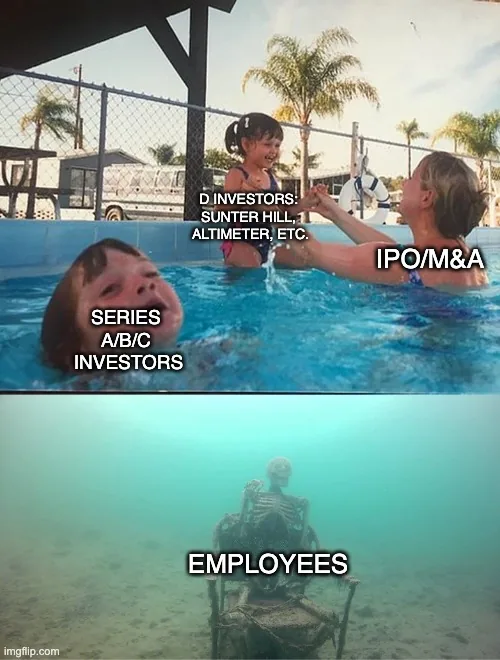

In July 2023, I joined Lacework.

And I thought it was a promising startup.

The company had raised $1.3 billion in a Series D round in late 2021, valued at $8.3 billion and backed by top VCs like Sutter Hill. On paper, it was one of the premier cybersecurity unicorns in the industry.

Just 12 months later, in August 2024, Fortinet acquired Lacework for $152.3 million in cash—a 98% drop from its peak valuation.

My options were wiped out.

That experience fundamentally changed how I view startup equity and funding headlines. When the current AI boom started producing multi-billion dollar valuations every week, I couldn’t help but ask: **If I were making a decision to join a startup today, what financial metrics could I actually inspect to avoid another Lacework?**

Caveats:

- It may be not fair to compare Lacework with some examples here, especially given different industries and also different time. However, just the financial metrics can apply.
- Meta colleagues — no I’m currently not looking to move
- I only have public information. Nothing secret.

---

## 1. Lacework in July 2023, financially

Looking back at July 2023, the metrics weren’t secret, but math could be. I found it easier to translate those into software engineering terms, so hopefully that works for you too:

### FIFO Queue: The Preferred Liquidation Stack

In venture capital, preferred investors get paid back before common shareholders.

By mid-2023, Lacework had raised **~$1.8 billion** in total capital with a 1x preferred liquidation preference. Think of this as a **$1.8B priority queue** sitting ahead of common stock.

Meanwhile, public cloud security companies (like CrowdStrike and Palo Alto Networks) had re-rated in 2022–2023 to trade at roughly **8x to 12x ARR**. With Lacework’s ARR sitting around $80M–$90M in July 2023, a realistic public market valuation was **$700M to $1.0B**.

Because the potential market value ($900M) was smaller than the priority queue ($1.8B), employee options were functionally underwater long before the acquisition.

### Memory Leak: Capital Efficiency

A useful metric for company health is the **Capital Efficiency Ratio**:

Capital Efficiency Ratio = *Total Capital Raised/Annual Recurring Revenue(ARR)*

A healthy, growing company typically converts $1.00 to $2.50 of raised capital into $1.00 of ARR. This is burning memory to generate throughput.

And we may have a memory leak.

In July 2023, Lacework had burned through **$1.8 billion** in capital to generate **~$90M in ARR**—a **20.0x Capital Efficiency Ratio**.

### The Valuation Multiple Disconnect

Lacework’s $8.3B paper valuation on ~$90M ARR represented a **90x ARR multiple**.

Compared to public software multiples, which crashed from 40x down to 10x in 2022, Lacework would have needed to scale ARR to **$830 million** just to catch up to its paper valuation. Combined with a 20% workforce layoff in May 2022—just 6 months after its peak funding round—the operational trajectory was severely misaligned with the paper valuation.

---

## 2. Inspecting Today’s AI Unicorns Against the Same Telemetry

Applying this exact framework to today’s top private AI startups reveals two very different categories of companies: those building with high capital efficiency, and those trading on extreme valuation premiums.

| Company | Est. Valuation (2026) | Est. ARR (2026) | Total Capital Raised | Capital Efficiency (*Raised/ARR*) | Valuation Multiple (*Valuation/ARR*) | Metric Profile |
| --- | --- | --- | --- | --- | --- | --- |
| **Midjourney** | ~$10.0B | ~$500M | **$0.0M** | **0.00x** | **20.0x** | Bootstrapped; zero preference stack |
| **Databricks** | ~$188.0B | ~$6.9B | ~$4.5B | **0.65x** | **27.2x** | Efficient enterprise scale |
| **Cursor (Anysphere)** | ~$60.0B | ~$4.0B | ~$3.4B | **0.85x** | **15.0x** | High developer traction |
| **Scale AI** | ~$29.0B | ~$1.0B | ~$2.7B | **2.70x** | **29.0x** | Balanced government & B2B ARR |
| **Mistral AI** | ~$15.0B | ~$1.0B | ~$3.05B | **3.05x** | **15.0x** | Moderate valuation multiple |
| **Harvey AI** | ~$11.0B | ~$300M | ~$1.3B | **4.33x** | **36.7x** | High growth premium |
| **Perplexity AI** | ~$23.0B | ~$500M | ~$1.72B | **3.44x** | **46.0x** | Elevated ARR multiple |
| **OpenAI** | ~$852.0B | ~$25.0B | ~$122.0B | **4.88x** | **34.1x** | Massive compute capex commitments |
| **xAI** | ~$230.0B | ~$500M | ~$45.0B | **90.00x** | **460.0x** | Pure compute infrastructure buildout |

### AI Isn’t Classical SaaS

I mentioned the caveat above, and pardon me for restating it, because the difference makes capital efficiency more critical.

In classical SaaS, marginal distribution cost approaches zero. Once you build the software, each new user is nearly pure profit margin. In AI, every single query consumes electricity, server bandwidth, and GPU silicon wear. Marginal compute costs scale **linearly or super-linearly with revenue**.

As Ed Zitron (the famous AI suspect) famously observed, AI model labs risk operating like a restaurant that loses money on every meal and plans to achieve profitability by serving more meals. This explains why OpenAI burned **~$20.9 billion in 2025** ($34 billion in spend against $13 billion in revenue).

It also explains why 1990s-style **vendor circular financing** has returned to tech:

- **Vendor Guarantees:** Nvidia negotiating a $250 billion credit guarantee for datacenter campuses leased to unrated AI startups (cc: OpenAI) to backstop GPU purchases.
- **Neocloud Debt SPVs:** CoreWeave and Nebius taking on $14B+ in debt backed directly by GPU collateral, where spot rental rate drops below $1.20/hr trigger mandatory debt paydowns.

High capital efficiency (*Capital Raised/ARR*) is far more vital in AI than in classical SaaS because linear compute costs prevent pure software margin expansion from masking cash burn.

### High-Efficiency Engines vs. Growth Premiums

- **The Bootstrapped & Efficient Tier (Midjourney, Cursor, Databricks):** Midjourney (0.0x ratio) operates without venture capital, giving employees zero liquidation preference stack overhead. Cursor (0.85x ratio) scaled code generation to $4B ARR while keeping capital raised low, demonstrating organic software pull without relying purely on VC subsidies.
- **The Growth Premium Tier (Harvey AI):** Harvey has scaled ARR rapidly from $100M in 2025 to $300M in 2026 across major law firms. Its 4.33x capital efficiency is far healthier than Lacework’s 20x. However, its **36.7x ARR multiple** means it carries a high growth premium—it needs continued ARR expansion to avoid valuation compression if public markets re-rate.

---

## 3. Anthropic & Private Equity Liquidity

Anthropic is frequently discussed. I have lots of friends in Anthropic, and `claude` is becoming my most frequent command line tool. How does it do?

### The Snapshot

- **Latest Valuation:** **$965 Billion** (Series H, May 2026)
- **Annual Recurring Revenue (ARR):** **~$74.1 Billion** (July 2026)
- **Total Capital Raised:** **~$132 Billion** (including strategic compute commitments from Amazon and Google)
- **S-1 Status:** Confidential Form S-1 filed June 1, 2026 (targeting Q4 2026 IPO)

### 1. Capital Efficiency: 1.78x

Capital Efficiency= (*132B Raised/74.1B ARR*)= **1.78x**

I’ve gotta say, it’s remarkable.

### 2. Valuation Multiple: 13.0x ARR

Valuation Multiple = *965B Valuation/74.1B ARR* = **13.0x**

Unlike Lacework’s 90x multiple, Anthropic sits at a **13.0x ARR multiple**. Public software leaders trade between 10x and 18x revenue. Because its private multiple is already aligned with public equity markets, an IPO at this valuation does not require a severe market re-rating.

### 3. Liquidation Preference Stack: 13.7%

With $132B in total preferred capital against a $965B valuation, the preferred stack accounts for only **13.7% of total enterprise value**. Common stock equity holds an estimated **~$833 billion in net equity value**, meaning employee options remain deep in the money.

### Private Equity Liquidity: Paper Value vs. Real Cash

In private equity analysis, two metrics govern fund health:

- **RVPI (Residual Value to Paid-In Capital):** The unrealized “paper value” of remaining assets.
- **DPI (Distributions to Paid-In Capital):** The actual cash returned to investors’ bank accounts.

Early investors in Anthropic (like Menlo Ventures, which turned a ~$1B investment across funds into a ~$14B paper stake) currently sit on massive **RVPI**, but **0.0x DPI**…

until the confidential Form S-1 submission on June 1, 2026 gets manifested.

---

I wish all my friends in AI startups best luck, and take good care.
