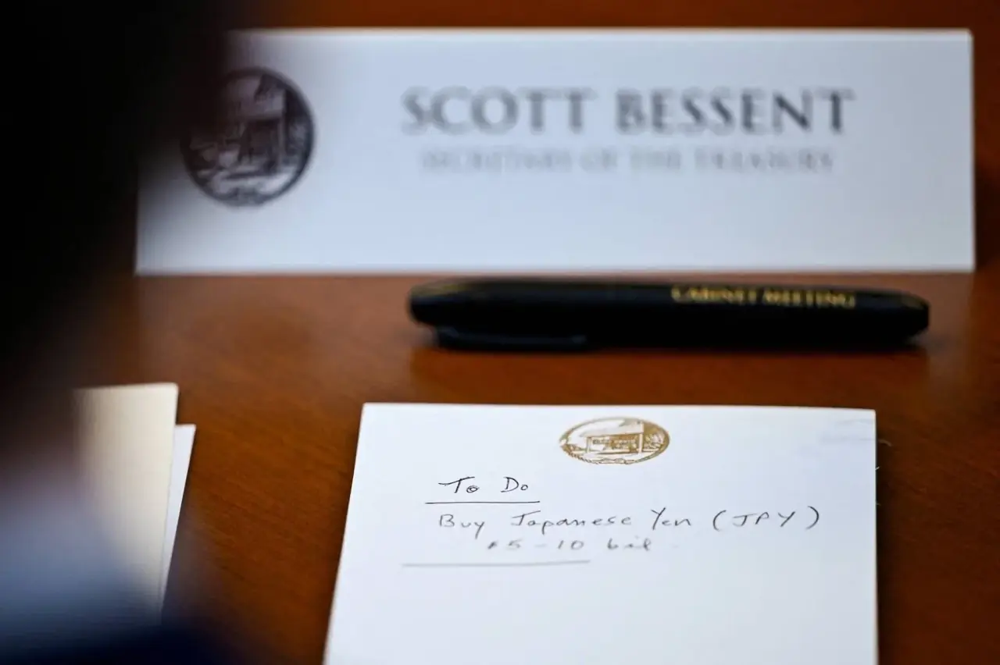

---

### 一、 两个世界的擦肩：从国内的紧绷到东京巷弄的黄昏

这段时间我和小乖在日本旅行。

除了对日本的蛋包饭念想已久之外，我这次来日本最主要的目的，在于亲身印证那些在书中反复读到的“失去的十年”——不，或许现今该被称为“失去的三十年”了吧。贝森特（Scott Bessent）那张备忘录里充满戏剧性的 `"To Do: Buy Japanese Yen (JPY) $5-10 bil"` 至今想来仍让人莞尔。我想去实地看一看当下的日本，原本预想着或许能在深夜居酒屋里撞见微醺的叹息，或者捕捉到空气中某种隐秘的绝望。

如果有的话，那种绝望或许类似于国内现实里弥漫的紧绷，是一种几乎难以化解的生存焦虑：深夜写字楼里不熄的通明灯火、外卖骑手在机动车道上为了抢几秒钟亡命穿行、社交平台上铺天盖地的降薪与裁员消息，以及今年爆发的“AI降智短剧”——在那些几十秒一反转的切片里，普通人被疯狂侮辱践踏，然后主角亮出百亿黑卡让反派当场下跪。

也许在白天的疲于奔命之后，用这种电子吗啡来麻痹透支的前额叶，真的管用。

但当我真正牵着小乖的手，走在东京、大阪与京都的居民巷弄里时，眼前的景象却截然不同。

傍晚五六点钟，居民区里极其安静，没有汽车鸣笛，也没有急躁的催促。路边是骑着自行车回家的中学生，神色虽有些着急，却丝毫不显焦急；超市里的货架上，整整齐齐地码放着新鲜蔬菜与熟食；路边的吉野家与唐吉诃德里，不管是年轻学生、中年工薪族还是白发老人，身上穿着优衣库与无印良品，得体而干净。

那是一种带着礼貌与分寸感、微笑却不喧哗的安详与松弛。

**一个被全世界断定为“失去了整整三十年”的国家，它的微观生活为什么不仅没有溃烂，反而维持着一种令人难以置信的体面与祥和？**

---

### 二、 忍者的“轴”？

我的第一反应，是日本人的“轴”。或者换一种说法，是职人精神、匠人文化，或者是文化基因里刻入骨髓的“隐忍”与“不给别人添麻烦（迷惑をかけない）”。在很长一段时间里，外界甚至有一种悲壮的叙事：面对泡沫破裂后的漫长寒冬，是大和民族靠着强大的集体纪律和牺牲精神，硬生生把这三十年给“熬”过来的。

但仔细琢磨一下，“熬”这个字，是有生理和心理极限的。

一个人可以熬过高考前的三个月，可以咬牙熬过一个季度的项目攻坚，甚至家里遇到重大变故，撑个三年五年，这都叫“熬”。但是熬的前提，是前方有一道光，是一处穿过泥潭后触手可及的彼岸。

**但三十年不是泥潭，三十年是整整半辈子。**

一个在 1990 年二十岁出头、满怀憧憬迈出大学校门的名校毕业生，等到三十年过去，他已经五十多岁了。人生最黄金的上升期被彻底焊死在时代的泥潭里，父母老去，黑发变白，曾经的希望与憧憬，已经凝固在相片与日记里了。

我想，没有任何一种文化或民族性格，能让几千万人处于高度痛苦、紧绷和恐惧的状态下硬生生熬过整整三十年。如果真靠硬熬，这个社会早就被自杀率、暴力犯罪和极端冲突撕得粉碎。

把这一切一言以蔽之地归咎于日本人的“轴”，其实是一种不负责任的智力偷懒，就像把国内打工人的过度加班轻佻地归结为“中国人天生爱吃苦”一样。

---

### 三、 有安全网，所以能体面停滞

我去查阅了日本在这三十年里的社保制度变迁和微观经济账本，才真正意识到：**日本普通人之所以能安详地度过这三十年，根本不是因为精神有多强大，而是因为这个社会在撞上天花板之前，就已经把底层的生存安全网全部织牢了。**

我把安全网解构为两个核心支柱：基本保险（医疗、养老、失业）与物价生活成本，中日之间在微观上存在着本质的断层：

#### 1. 医疗险：“绝对自费封顶”

**很多人不知道，中日医保最大的差异不是表面的报销比例，而是“封顶线到底画在谁头上”。**  
在国内，医保封顶的是“基金最高赔付限额”，超出限额部分或者目录外的靶向药、进口耗材，个人自费上不封顶，一场重病极易掏空一个普通家庭三代人的积蓄。  
而日本从制度设计上彻底反转了这个逻辑：它通过“高额疗养费制度”，把封顶线死死画在“个人每月最高自掏腰包的金额（Max Out-of-Pocket Cap）”上。  
对于一个普通工薪家庭（年收入 370 万–770 万日元），无论你得了白血病还是住进 ICU，使用再昂贵的新型免疫疗法，**每个月个人自费的上限就是大约 8 万日元（约合 4,000 元人民币）**。如果一年内生病超过 3 个月，第 4 个月起上限直接腰斩到 4.4 万日元（约 2,100 元人民币）。  
这意味着，**在日本生重病，绝不会演变成一场在财务上将全家凌迟的灾难。**

#### 2. 养老险：“国民年金”与体制特权破除

日本的养老体系实行的是“二阶建”。最底层的第一层叫“国民年金”，全日本所有 20 到 59 岁的人——不管是三菱重工的社长、大学教授还是全职主妇、打零工者，全员都在同一个底座里。国家财政直接补贴 50%，缴满 40 年每人每月拿约 6.8 万日元（约 3,300 元人民币）。  
更关键的是，**日本在 2015 年通过“被用者年金一元化”，彻底废除了公务员专属的退休金特权（共济年金）**，强制将公务员与普通私企员工全部并入同一个“厚生年金”池子。一对普通退休夫妻月均能拿到 22 万–23 万日元（约 1.1 万人民币）的稳定退休金。  
正因为退休金底座足够稳固，在日本甚至诞生了一种奇特的社会现象：很多低欲望、打零工的年轻人哪怕暂时不工作，依靠父母每月二十多万日元的稳定退休金，一家人也能过得相当体面。  
**在日本，连“啃老”都是有扎实制度兜底的。** 而在缺乏充足养老保障的社会里，老人的赡养与就医反而成了年轻一代身上无论如何都不敢停歇的沉重负累。

#### 3. 失业险：不需要主动“被”辞职

在国内，失业金申领门槛极其苛刻，往往要求用人单位开具非自愿中断就业证明，一旦被迫签了“自愿离职”就一分钱拿不到，导致很多企业通过降职调岗、孤立排挤等手段逼迫员工主动“被辞职”。  
但在日本，**就算你干得不爽、主动裸辞（`自己都合退职`），只要过去两年累计缴满 12 个月社保，度过一两个月限制期后，照样可以全额领取离职前工资 50%–80% 的失业金**（每月最高可领近万元人民币，长达数月），甚至政府还报销 50%–80% 的职业技能培训学费。  
正因为有了这个退路，90 年代后的日本年轻人才有底气下班准点走人、推掉无意义的陪酒应酬，把工作还原成纯粹的“8小时劳动换取现金”。

#### 4. 平价生活的尊严感

支撑这种松弛感最核心的经济前提是：**日本是在人均 GDP 已经全面超越美国的高位上撞墙的。**  
1990 年资产泡沫见顶时日本人均 GDP 达 2.6 万美元（同期美国约 2.3 万美元），而在 1995 年通缩深水区前夕，日元暴升推动名义人均 GDP 冲到了近 4.5 万美元的历史巅峰（相当于当时美国的 1.57 倍）。  
同时，它拥有连续几十年全球第一的海外净资产（GNP 远大于 GDP），海外产业链的分红利息如同一股看不见的地下暗流，源源不断地回流本土；自来水拧开直饮，社会治安极佳，贫富分化处于全球最低行列。  
在这样的社会里，优衣库把衣服做到了极致平价耐穿，萨莉亚把意面做成了学生食堂；**在当年的通缩大战中，吉野家甚至把一碗牛肉饭硬生生杀到了 280 日元——即便在经历了近几年全球大通胀与日元贬值的今天，一碗热腾腾的牛肉饭依然卡在 498 日元（约合人民币 23 元，一枚 500 日元硬币就能吃饱）的平民基准线上。**  
**最重要的是，这种便宜毫无羞耻感。** 当昂贵的消费不再能带来虚荣的优越感，廉价也就褪去了底层的烙印。一个人哪怕只靠微薄的时薪，只要不乱加杠杆，就能在一个极低的成本线上过得体面而有尊严。

---

### 四、 为什么“中国甚至很难失去三十年”？

理解了日本这三十年的微观底色，再回看我们自己的土地，一种深沉的忧虑便油然而生。

在财经语境里，很多人都在谈论“中国正在日本化（Japanification）”。但正如《华尔街日报》几位资深中国问题专家在一篇犀利的报道中指出的那样：**对中国而言，日本过去走过的这三十年根本不是一个警示，而是一个甚至很难企及的“最好剧本”。**

因为支撑日本平稳软着陆的四大前提，我们几乎一条都不具备：

1. **未富先老的断层（$1.2 万 vs. $4 万）**：  
   日本撞墙时人均 GDP 已经超越美国，全社会公共基础设施早已完备，民间中产阶级积累了极其厚实的财富（皮下有一层厚厚的“战略脂肪”）。而中国是在人均 GDP 仅 1.2 万至 1.3 万美元（仅为当前美国 15% 的半山腰）时，就迎来了极端严峻的人口老龄化拐点与地产收缩。
2. **社保底座的鸿沟（身份特权 vs. 30–50 倍剪刀差）**：  
   与日本全民统筹的国民年金不同，我们的养老体系存在着巨大的鸿沟。体制内退休人员每月领着 6,000–9,000 元的高额养老金，而占全国老年人口半数以上的 1.7 亿农村及城乡居民老人，每个月的基础养老金全国最低标准仅 143 元（实际全国均值仅约 220–250 元），差距高达 30 到 50 倍。普通年轻人的父母很难提供“托底”的资本，其重疾与养老反而是年轻一代不敢停步的沉重负担。
3. **负债主体的错位（企业衰退 vs. 六个钱包锁死）**：  
   1990 年日本家庭资产中，不动产也占了近六成，表面上看与今天中国城镇家庭的 70% 相差无几。**但二者最致命的区别，在于杠杆究竟加在谁身上，以及谁来承担代价。**  
   当年日本爆炒地皮加杠杆的主力是企业与金融财团，大衰退后拼命还债、承受资产负债表衰退的是企业；普通日本家庭的储蓄底座依然深厚，并没有被全员锁死在三十年的刚性房贷里，更有完善的个人破产法作为生存托底。  
   而中国过去十年的地产繁荣，是通过“涨价去库存”，把杠杆精准转移到了千家万户的居民头上——掏空“六个钱包”凑首付，背上动辄二三十年的刚性按揭，居民债务占可支配收入比重飙升至 130% 以上。
4. **产能过剩（出海顺风车 vs. 全球关税壁垒）**：  
   当年日本制造业仅占全球 10%–15%，恰逢全球化浪潮的顺风车，得以顺利“出海再造一个日本”。而今天中国制造业占全球 30% 以上，国内消费仅占 GDP 的 39%。世界其他国家在数学上根本无法消化如此庞大的过剩产能，等待我们的是全方位的关税铁幕。外循环面临堵截，内循环因老百姓不敢花钱而疲弱，企业只能在国内把彼此绞杀至零利润。

**日本当年是“富足地停滞”，而我们面对的可能是“未富先老、缺乏兜底的刚性内卷”。**

当一个人脚下没有安全网时，他是无法“松弛地低功耗待机”的。他只能继续死守 45% 的预防性储蓄，在日趋狭窄的职场通道里自相残杀，然后把所有的疲惫与焦虑，寄托于手机里的 AI 降智短剧——因为只有在那里，因果报应才是确定且迅速的。

---

### 五、 宏观有解药，但官方会喝吗？

那么，面对这种困局，真的无解吗？

从纯经济学的第一性原理来看，解药是极其明晰的。国内外许多有良知的学者和经济学家都提出过近乎一致的四张制度手术单：

1. **打破金融抑制：国资划转全民社保**：  
   中国政府手里握有上百万亿的国有企业股权和资产，这是西方国家所没有的王牌。如果能停止每年对过剩产业园的无效补贴，将国企 30%–50% 的真实分红划入统筹社保，把 1.7 亿农村老人的养老金从 200 多元拉升到 1,000–1,500 元，同时医保建立日本式的“月度个人自费封顶”。**只要把这 9 亿底层与中产家庭从“因病致贫、老无所养”的恐惧中解放出来，中国高达 45% 的储蓄率只要释放 10%，就能凭空创造出每年 10 万亿级的人民币内需，瞬间消化掉国内绝大部分工业产能。**
2. **重构 1994 分税制，中央统收统支民生底线**：  
   彻底改变“中央拿走大头税收、地方承担 85% 民生支出”的畸形架构。由中央发行超长期国债，直接接盘全域的义务教育、基本医保和基础养老金，把地方政府从卖地还息与“远洋捕捞式”罚没民企的绝境中解救出来。
3. **户籍平权与土地资本化**：  
   让 3 亿在城市打工的农民工真正拥有市民待遇，激活宅基地和农地流转，让农民第一次拥有合法的财产性收入。
4. **用“AI + 绿电 + 自动化”对冲劳动力人口下滑**：  
   将中国举世无双的电网、核电、煤化工和工业自动化，作为应对老龄化的武器，用机器代替人工，并将自动化带来的生产力红利反哺全社会。

**然而，理想很丰满，现实很骨感。**  
从博弈论的角度看，为什么过去十几年大家反复呼吁“促消费、建安全网”，但政策却总是回到“对供给端单边补贴”的老路上？

因为**任何分配改革，动用的从来不是技术，而是既得利益集团的权力与蛋糕**。  
要把占 GDP 10%–15% 的资源从“政府、国企与投资端”转移给“普通居民端”，意味着要削弱审批基建的行政权力，要剥离体制内的特权福利。同时，决策层在意识形态上长期把直接发钱、普遍福利视为“养懒汉的拉美陷阱”，更倾向于能看得见摸得着的工业产能。

官方会不会喝下这碗苦口的猛药？我们不知道，也无法预测。把自己的未来押注在宏观政策的突然觉醒上，是极其危险的。

---

### 六、 个体如何建立属于自己的“富足停滞”？

如果我们认清了宏观安全网可能短期内无法降临，那么最理性的做法，绝不是迎着时代的风暴去硬撞，而是**在自己的家庭资产负债表上，亲手建好属于自己的“日本式缓冲垫”**：

#### 1. 建立个人版“GNP > GDP”的全球资产底座

日本能扛过三十年，靠的是海外庞大的净资产分红回流本土。  
我们个人也必须打破单一主权货币与单一地区金融抑制的闭环。通过全球化的资产配置——持有以美元计价、具备全球垄断定价权的优质资产（如微软、伯克希尔、谷歌）、抵御法币购买力稀释的实物黄金、以及零信用风险的现金国债储备（T-Bill），为你和家人打造一套**全方位的跨国“个人厚生年金与医疗大病基金”**。

#### 2. 舍却与缩减人生：扒掉虚荣的那层皮

在收缩期里，最先被绞碎的往往是那些在繁荣期里被消费主义深度绑架、背负高杠杆维持虚假体面的人。  
学一学日本普通人的生存智慧：**知晓什么是“不需要”，才能够真正看清自己“需要”什么。** 不要为了向毫无意义的同龄人证明自己，而去背负刚性的生活成本。  
我很喜欢硅谷投资人 Naval 的一句话：**如果你在嫉妒某个人，问问自己，是否愿意 100% 与他交换整个人生？** 交换他的健康、他的焦虑、他的家庭创伤、他的睡眠质量与全部过往。如果答案是否定的，那么你的嫉妒就毫无意义。  
衣服以舒适得体为先，饮食以天然健康为底，不为廉价而过度消费，也不为虚荣而透支未来。人一旦把人生清单里那些虚无缥缈的光环卸下来，生活的硬性成本就会出现断崖式下跌。

#### 3. 守护前额叶的余闲

不要在夜晚把自己的大脑交给算法投喂的垃圾信息和降智短剧。  
认知带宽是我们对抗不确定性最珍贵的资本，而资本应该去创造现金流，而非浪费在无用的“消耗”上。留出时间去运动、去深度睡眠、去与朋友散步交谈、去进行放空与思考。

---

大风刮过来的时候，就顺着风势走；风停了，就在路边坐下来吃一碗廉价但干净的便当。在这个充满巨大不确定性的时代里，能够保持内心的秩序、守护家人的平安，并在有限的资源里把日常的一蔬一饭打理得安详而体面，这本身就是一种最强大的英雄主义。
